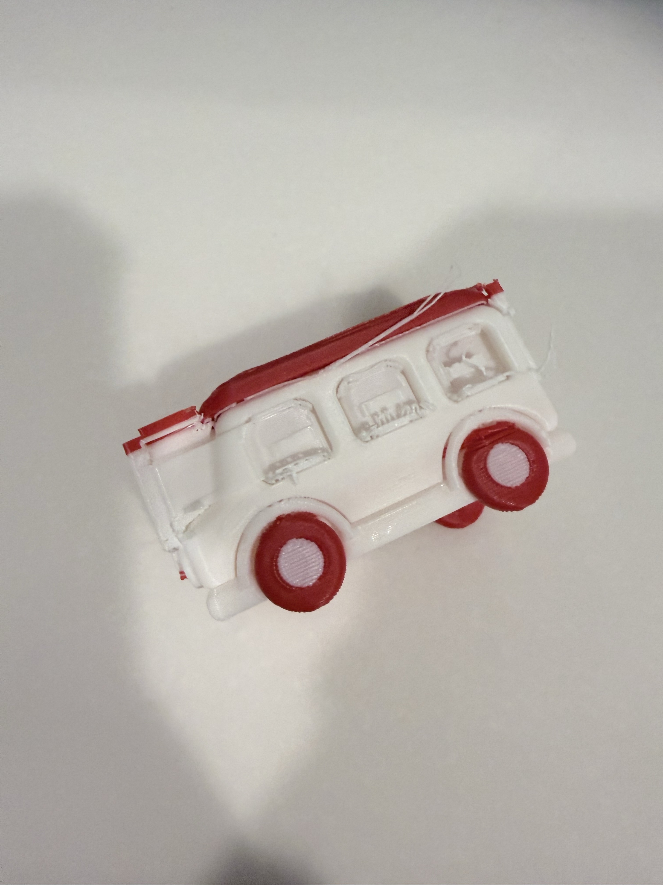
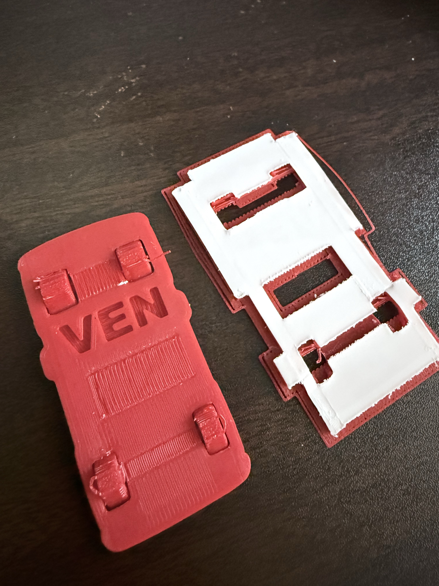
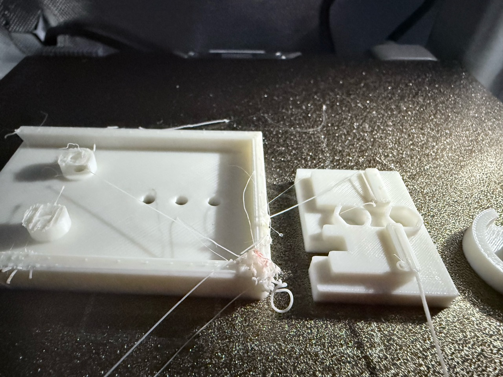

# ネコネコインダストリー

**NEKONEKO INDUSTRIES**

> **わくわくを、どこへでも。**
>
> Wonder to Go.

ねこのAI職人たちが乗り物のおもちゃを作る工場をテーマに、FreeCADとA1 miniで設計・試作するプロジェクトです。人間のレビューと造形結果を記録し、次の設計に生かしています。

バスに加え、船、車、ローバーの試作・造形検証にも取り組んでいます。独自設計と外部モデルのベンチマークを区別し、完成した印刷物だけでなく、検証片や失敗も記録しています。過去のCADや記録のファイル名には、当時の設計を示す「NEKOMO」が残っています。

## ねこ船長と、次の冒険へ

2026年11月13日、猫と帆船を組み合わせた38「ねこ船長」を正式ロゴに採用しました。小さな船に乗って出かける猫の姿に、身近なおもちゃから冒険が始まる楽しさを重ねています。

[会社名・採用ロゴ](docs/brand/identity.md) · [01〜40案の比較履歴](docs/brand/README.md) · [採用案を含む36〜40案](docs/brand/cat-sailship-logo-concepts.md)

設計の変化は下のギャラリーと版別データから確認できます。審査や印刷の結果は、[バスの版一覧](docs/バスの版一覧.md)と[人間のレビュー記録](docs/人間のレビュー記録.md)にまとめています。

## プリントしたモデルと検証の記録

**2026年11月15日更新。** 公開済みの完了報告・機械記録・実物写真を照合した一覧です。製品カタログではなく試作記録であり、印刷完了と品質合格は別です。実物写真がない版をCAD画像で「完成品」に見せることはしません。

### 本体の印刷完了を確認したモデル

| モデル | 確認できた結果 | 残る確認・出典 |
| --- | --- | --- |
| バス v06・赤タイヤ | 本人が印刷完了を報告。実物写真あり | **サポート除去NG**。写真とジョブIDの直接照合は未確認。[品質記録](docs/evidence/print-quality-feedback.json) |
| バス v09・傾斜ボンネット | FINISH・100%・119層と本人の完了報告 | 完成品の品質レビューは未記録。[印刷記録](docs/evidence/print-confirmation.json) |
| BEN・クリスマス3色 | 2026-11-12、250/250層・100%と本人の完了報告。生成サポートなし | 屋根裏の仕上がり、寸法、浮力は未検証。BENの造形を参考にした記録で、独自設計品とは区別。[完了記録](quality/print-knowledge/ben-roof-bridge-20261112/completion-record.json)・[設計への知見](quality/print-knowledge/ben-roof-bridge-20261112/README.md) |
| Riding Car Model・60 mm | 2026-11-14の記録に本人の完了報告と実物写真 | **JaKubina作の外部ベンチマーク**。保存キャッシュと実送信ジョブの直接照合は未確認。[分析記録](quality/print-knowledge/riding-car-supportless-20261114/README.md)・[原作者の配布先](https://makerworld.com/en/models/1410834) |

| Pick-Up Bench r02・60 mm本体 | 2026-11-14 JST、FINISH・100%・183/183層。Codex履歴と保存済み終了記録を照合し、カメラ確認の記録も確認 | 本体の支持材除去、タイヤ・屋根の細部は実物確認待ち。底部4 mm検証片の除去成功とは別判定。モデル棚卸し（`docs/models-inventory.md`） |

### 実物写真

以下はすべて既存の公開実写です。写真は掲載した版の記録で、後続版の改善証拠ではありません。

| Riding Car Model：外部ベンチマークの造形品 | バス v06：サポート除去NGの記録 |
| --- | --- |
|  |  |

### 検証片・不具合のある印刷物

完成車や改善成功品とは分けて掲載します。[写真15枚と対応表](quality/history-review-20261113/photos.md)から、報告された版と元記録を確認できます。

| 対象 | 造形したもの・結果 | 次に確認すること |
| --- | --- | --- |
| Pick-Up Bench r01 | 底部4 mmの検証片。タイヤ周辺の破損報告。本体ではない | 破損段階、支持と除去性。r02は底部4 mm検証片の除去成功を本人が報告。本体の品質とは混同しない。[経緯](quality/history-review-20261113/boat-rover-cases.md) |
| バス v10 | 窓・屋根の検証片。サポートを剥がす際に窓枠が折れたとの報告 | 改修後の実物強度と除去性。[経緯](quality/history-review-20261113/bus-cases.md) |
| Porsche911・r01検証片 | 本体のサポート除去NG、後続検証片もタイヤ・剥離面の品質NG | 支持材の局所接触、剥離時の破損。[TR-004/005の要約](docs/過去の不具合と再発防止.md) |
| LYNX r05 | 2026-11-14、本人の「できた！」という完成報告と写真5枚を記録。その後、窓付近の樹脂線の湾曲・垂下を追加報告。**本体は印刷済み、実物品質NG** | 車輪の回転・走行、車軸の保持・強度は未確認。窓輪郭の支持・押出順序への対策効果も未検証。[TR-006の要約](docs/過去の不具合と再発防止.md) |
| ミント | 本人が印刷完了と側窓の垂れを報告。実物品質NG | LYNXと同種の経路条件が残存。対策済みとは扱わない。[TR-007の要約](docs/過去の不具合と再発防止.md) |
| ローバー R11 | 白部品に線状の樹脂、ねじ固定部の荒れ、屋根角の塊。造形不良の記録 | 原因と再造形の品質。車両全体の完成とは扱わない。[停止・校正の記録](quality/history-review-20261113/solaris-workflow-cases.md) |

| Pick-Up Bench r01：底部検証片 | ローバー R11：白部品の造形不良 |
| --- | --- |
|  |  |

[バスv10の検証片写真](quality/history-review-20261113/photos/v10-01.jpg)も公開しています。

### 開始・設計検証段階のモデル

船も複数系統で試しています。**開始記録があることを完了に、ファイル検査合格を実物合格には読み替えません。** 保存済みの版別READMEとモデル棚卸し（`docs/models-inventory.md`）を照合した状態です。棚卸しにはローカル保管分も含まれ、全データが公開済みという意味ではありません。

| モデル | 最後に確認できた段階 | 未確認部分 |
| --- | --- | --- |
| Benchy Boat 80 r01 | 印刷開始・自動ベッドレベリングまでを記録。Codex履歴とも照合 | 完了、表面品質、浮力。3色BENとは別モデル |
| 英国ナローボート r01 | 窓検証片を送信しRUNNINGを記録 | 検証片の完了・除去性。本体は検証片合格まで未送信 |
| Porsche911 r08 | 閉床と空洞の設計・スライス検証。未印刷 | タイヤ欠け、支持材除去性。CADレンダーを実写として扱わない |
| トロール漁船 r05 | サポート材・局所接触のファイル検査合格。未印刷 | 実機材料割当、実物除去性、浮力・強度 |

印刷完了は、外観・強度・耐久性・浮力や子どもの使用可否を確認したことを意味しません。公開記録に、子どもの使用を承認した版はありません。v04には保存CADのハッシュ不一致が残り、再梱包は停止しています。[照合記録](docs/evidence/v04-packaging-check.json)

## バス設計の一例：v09

**v09・傾斜ボンネット案**は、42 × 21 × 24 mmの床なしバスです。ボンネットの形を見直し、逆さ姿勢での造形経路を調べました。画像はCADレンダです。

[v09のFreeCADモデル](designs/school-bus-v09-sloped/cad/sloped-bus.FCStd) · [STEP](designs/school-bus-v09-sloped/exports/sloped-bus.step) · [スライス済み3MF](designs/school-bus-v09-sloped/exports/sloped-two-color-sliced.3mf) · [設計スクリプト](designs/school-bus-v09-sloped/build_sloped.py) · [版の案内](docs/designs/school-bus-v09-sloped/版の案内.md)

## 設計ギャラリー

画像は各版のCADレンダです。形状の違いと設計記録を見比べられます。

| v02・大型3部品 | v03・60 mm級の3部品 |
| --- | --- |
|  |  |
| 車体・シャーシ・屋根を分け、位置決めと部品の干渉を確認しました。[CAD](designs/school-bus-v02/cad/nekomo-school-bus-v02.FCStd) · [設計記録](docs/designs/school-bus-v02/版の案内.md) | 赤白の配色と60 mm級の大きさに合わせ、肉厚と組立形状を調整しました。[CAD](designs/school-bus-v03-mini/cad/nekomo-school-bus-v03.FCStd) · [設計記録](docs/designs/school-bus-v03-mini/版の案内.md) |

| v04・60 mm級の一体構造 | v07・40 mm級の床なし構造 |
| --- | --- |
|  |  |
| 屋根と底板を一体化し、幅34 mmの形状と内部の補強を検討しました。[CAD](designs/school-bus-v04-dr/cad/nekomo-school-bus-v04.FCStd) · [設計記録](docs/designs/school-bus-v04-dr/版の案内.md) | 床をなくし、窓の開口、輪の張り出し、赤白の色境界を見直しました。[CAD](designs/school-bus-v07-open-bottom/candidate-r00/cad/nekomo-bus-v07-final.FCStd) · [設計記録](docs/designs/school-bus-v07-open-bottom/版の案内.md) |

| v07・底側から見る空洞 | v09・逆さ姿勢で見るボンネット |
| --- | --- |
|  |  |
| 開いた底面と車内の形状を確認しました。G-codeでも空洞中央を横切る押出経路を調べています。[レビュー記録](docs/designs/school-bus-v07-open-bottom/evidence/design-review-r00.md) | 前層との経路の重なりをボンネット中央で調べました。[検査コード](designs/school-bus-v09-sloped/verify_toolpaths.py) · [比較手順](docs/reproduce.md) |

## バス各版の設計データ

v06は40 mmのシンプル版と60 mm級の空洞版が別系統です。赤タイヤ版は60 mm級の空洞版から派生しています。各行からCAD、造形データまたは版ごとの記録へ進めます。

| 版・派生 | 設計の違い | FreeCAD | 造形データ・記録 |
| --- | --- | --- | --- |
| v01 | 大型・一体固定輪。外観と窓上端の橋渡しを検討 | [CAD](designs/school-bus-v01/cad/nekomo-school-bus-v01.FCStd) | [2色3MF](designs/school-bus-v01/print/nekomo-school-bus-v01-two-color-sliced.3mf) · [版の案内](docs/designs/school-bus-v01/版の案内.md) |
| v02 | 車体・シャーシ・屋根の3部品 | [CAD](designs/school-bus-v02/cad/nekomo-school-bus-v02.FCStd) | [3部品の造形データと記録](docs/designs/school-bus-v02/版の案内.md) |
| v03 | 60 mm級・赤白・3部品 | [CAD](designs/school-bus-v03-mini/cad/nekomo-school-bus-v03.FCStd) | [3部品の造形データと記録](docs/designs/school-bus-v03-mini/版の案内.md) |
| v04 | 60 mm級・幅34 mm・一体構造 | [CAD](designs/school-bus-v04-dr/cad/nekomo-school-bus-v04.FCStd) | [3MF](designs/school-bus-v04-dr/print/final-bus-sliced.3mf) · [版の案内](docs/designs/school-bus-v04-dr/版の案内.md) |
| v05 | 底面2開口とサポート除去の検討 | [CAD](designs/school-bus-v05-dfam/cad/nekomo-school-bus-v05-open-underside.FCStd) | 本体のスライスなし · [検証片と記録](docs/designs/school-bus-v05-dfam/版の案内.md) |
| v06・シンプル | 40 × 20 × 22 mm・単色・一体 | [CAD](designs/school-bus-v06-simple/candidate-r01/cad/final-bus-r01.FCStd) | [3MF](designs/school-bus-v06-simple/candidate-r01/print/school-bus-r01-sliced.3mf) · [版の案内](docs/designs/school-bus-v06-simple/版の案内.md) |
| v06・空洞 | 60 mm級・床と座席を抜いた車内 | [CAD](designs/school-bus-v06-empty-inverted/corrected/nekomo-v06-clear-cabin.FCStd) | [設計・造形記録](docs/designs/school-bus-v06-empty-inverted/版の案内.md) |
| v06・赤タイヤ | 赤い屋根・タイヤ、白い車体・ハブ | [CAD](designs/school-bus-v06-empty-inverted/two-color-red-tyres/nekomo-v06-red-tyres.FCStd) | [スライス済み3MF](designs/school-bus-v06-empty-inverted/two-color-red-tyres/red-tyres-inverted-sliced.3mf) · [不具合記録](docs/evidence/print-quality-feedback.json) |
| v07 | 40 mm級・床なし・空洞・2色 | [CAD](designs/school-bus-v07-open-bottom/candidate-r00/cad/nekomo-bus-v07-final.FCStd) | [3MF](designs/school-bus-v07-open-bottom/candidate-r00/print/bus-two-colour-final.3mf) · [版の案内](docs/designs/school-bus-v07-open-bottom/版の案内.md) |
| v08 | 42 × 21 × 24 mm・写真型のボンネット | [CAD](designs/school-bus-v08-photo/cad/photo-bus-fast.FCStd) | [3MF](designs/school-bus-v08-photo/exports/fast-two-color-sliced.3mf) · [版の案内](docs/designs/school-bus-v08-photo/版の案内.md) |
| v09 | 42 × 21 × 24 mm・連続した傾斜ボンネット | [CAD](designs/school-bus-v09-sloped/cad/sloped-bus.FCStd) | [STEP](designs/school-bus-v09-sloped/exports/sloped-bus.step) · [3MF](designs/school-bus-v09-sloped/exports/sloped-two-color-sliced.3mf) · [設計スクリプト](designs/school-bus-v09-sloped/build_sloped.py) · [版の案内](docs/designs/school-bus-v09-sloped/版の案内.md) |

## 設計審査と品質方針

[バスの版一覧](docs/バスの版一覧.md)には、版ごとの設計差、当時の要望、DRの審査履歴、印刷・現物の記録があります。DR番号と判定は記録当時の履歴として保持し、別の定義へ読み替えていません。審査の進め方と記録様式は[設計審査手順](.agents/skills/nekoneko-dr-review/SKILL.md)を参照してください。

PLAモデルにサポートが必要な場合は、専用のSupport for PLAを本体との接触面へ明示的に割り当てます。スライス後の界面経路と本体への材料混入がないことをファイルで確認し、送信前に実物AMSとの対応を確かめます。工具の通り道や破損リスクを設計で検討し、代表形状の検証片で実際の除去を確認します。ファイル検査と実物での除去確認は別の記録です。[サポート材のファイル検査](quality/support-removal-preflight.py)

人間の要望、エージェントの検査、機械記録、実物の報告を分けて保存しています。[人間のレビュー記録](docs/人間のレビュー記録.md) · [公開データ](docs/data/) · [v06赤タイヤ版の品質記録](docs/evidence/print-quality-feedback.json)。ファイル検査や印刷完了だけで、製品の品質や子どもの使用可否を判定しません。

## 取得して検証する

GitとPython 3.12を用意し、リポジトリのルートで実行します。

~~~sh
git clone https://github.com/Sunwood-ai-labs/NEKONEKO-INDUSTRIES.git
cd NEKONEKO-INDUSTRIES
python tools/update_manifest.py --check
python tools/verify_snapshot.py
~~~

[取得後の検証と再現手順](docs/reproduce.md)では、公開ファイルの照合、サポート材の検査、v08とv09の経路比較、v09のCAD生成を案内しています。[GitHub Actionsの検証結果](https://github.com/Sunwood-ai-labs/NEKONEKO-INDUSTRIES/actions/workflows/verify.yml)

## リポジトリの中身

~~~text
designs/                          版ごとのCAD・STEP・STL・3MF・設計コード
docs/                             設計記録、人間のレビュー、再現手順
docs/brand/                       採用ロゴ、ブランドの基本情報、01〜40案の比較履歴
.agents/skills/nekoneko-dr-review/ DRの審査方法と記録様式
quality/                          サポート材のファイル検査
tools/                            マニフェスト更新・スナップショット検証
~~~

活動の背景と品質方針は[コンセプトと品質方針](docs/NEKONEKO-INDUSTRIES-concept-and-quality.md)にあります。

## ライセンス

[MITライセンス](LICENSE)の適用範囲は、本プロジェクトで作成したCADモデルとそのSTEP・STL出力、および制作・検証コードです。
