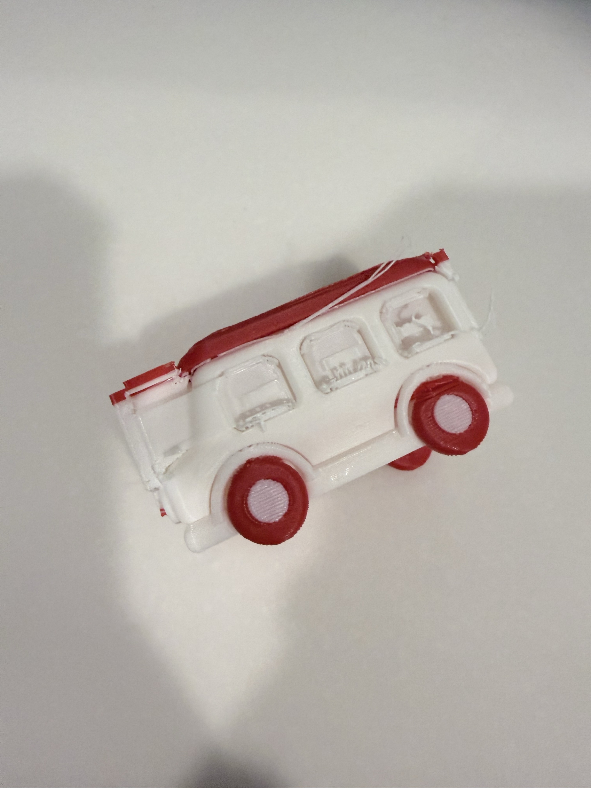
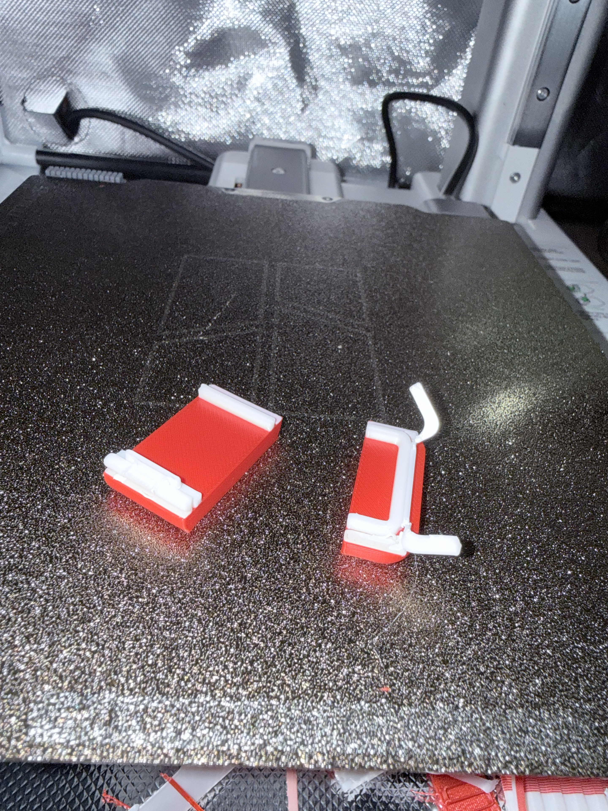
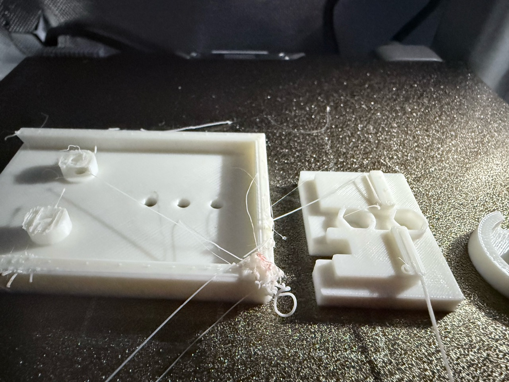
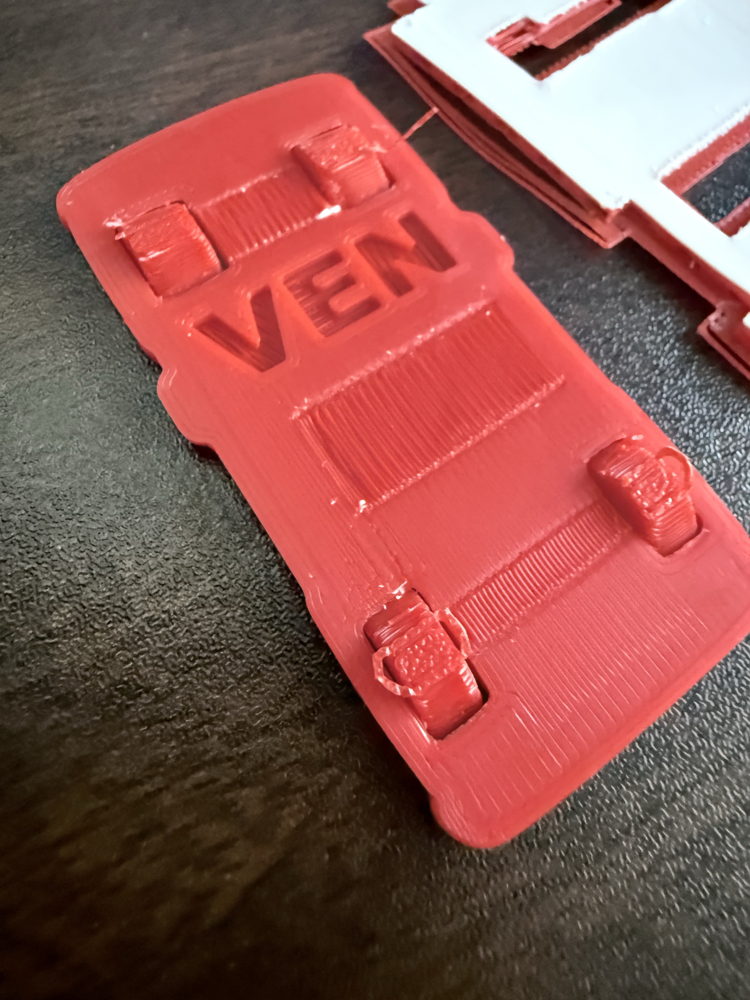

# 過去の不具合と再発防止

2026-11-13に、ネコネコインダストリーの過去チャットと保存データを調べた記録です。実物の失敗、設計・検証の問題、作業ツールの失敗、未確認事項を分けて記載しています。

## 実物で報告された問題

| 対象 | 起きたこと | 確認できた範囲と現在の扱い | 詳細 |
| --- | --- | --- | --- |
| ミニバスv06赤タイヤ版 | サポートがほぼ外れない | 実物のサポート除去NG。専用材の装着はあったが実送信データには未割り当て。改善の実物確認とは区別 | [TR-001](../quality/print-failure-20261110/過去トラ-NEKOMO-TR-001.md)、[バスの追跡調査](../quality/history-review-20261113/bus-cases.md) |
| バスv10の窓・屋根検証片 | 専用界面材を指定したデータで印刷後、サポート剥離中に窓枠が破損 | v06の除去NGとは別の実物不具合。その後の厚み・断面の修正と、実物での改善確認を区別 | [バスの追跡調査](../quality/history-review-20261113/bus-cases.md) |
| ローバーR11の白部品 | 屋根角の樹脂の塊、ねじ固定部上面の崩れ | 造形不良で中止。ナット穴の支持、押出状態、移動後の校正を切り分ける必要があり、原因未確定 | [造形不良と停止・校正の記録](../quality/history-review-20261113/solaris-workflow-cases.md) |
| Pick-Up Bench r01の底部4 mm検証片 | タイヤ周辺の破損 | TR-003。専用界面材を使い、20/20層で完了しても実物は破損。その後r02でラフトと4輪直下の界面経路を確認し、利用者が検証片の改善・除去成功を報告。本体での確認は未実施（2026-11-14に後続記録を反映） | [TR-003](../quality/print-failure-20261113-pick-up-bench/過去トラ-NEKOMO-TR-003.md)、[追跡調査](../quality/history-review-20261113/boat-rover-cases.md) |

TR番号のない行は今回の追跡調査で整理した実物報告です。既存の正式登録番号を変更したり、重複して採番したりしていません。[不具合一覧](不具合一覧.md)のTR-001、TR-003は引き続き参照できます。

## 追加の実物報告

2026年11月14日、LYNX r05の窓付近に樹脂線が湾曲・垂下して残る報告と写真2枚を受領し、[TR-006](../quality/print-failure-20261114-lynx-window/過去トラ-NNI-TR-006.md)へ登録した。追加の[なぜなぜ分析](../quality/print-failure-20261114-lynx-window/analysis/root-cause-analysis.md)で、第214層の足場の乏しい窓輪郭をBridge充填より先に押し出す経路を特定した。写真との照合から、輪郭の定着失敗と崩落を主因として強く支持する。直線Bridgeだけでなく、窓を囲むOverhang wallの支持・押出順序を検査する。対策効果は未検証で、実物品質NGを維持する。サポート経路0やファイル検査の合格を実物品質の合格へ読み替えない。

2026-11-13にポルシェ911模型のサポートが取れないとの報告と写真4枚を受け、[TR-004](../quality/print-failure-20261113-porsche911/過去トラ-NEKOMO-TR-004.md)として登録しました。車体下面・タイヤ周辺に支持構造が残っています。実物の除去NGは利用者報告で確認しましたが、材料・設定・実ジョブの対応と物理原因は未確定です。TR-001の除去性、v10の剥離中破損、TR-003のタイヤ周辺の破損を関連事例として参照します。写真の色だけで専用材の使用有無を決めず、最終経路の材料確認と実物の除去結果を分けます。

## TR-005の再発防止

標準の `python quality/support-removal-preflight.py <最終スライス3MF>` に局所接触リンターを組み込む。実G-codeの全層・全XY範囲について、モデルの下面高さと支持の上面高さ、および線幅を使った接触を調べる。本体用PLAの支持がモデル直下に接する箇所は `NNI-TR-005` で `BLOCK` とする。専用界面が別の場所にあっても、この判定を省略しない。

円弧や材料切替も解析し、対応外の経路・不足する寸法情報は合格にせず `BLOCK` とする。合成3MFによる回帰試験をCIに追加し、今回の失敗した実3MFでも不合格になることを確認する。これは公称経路の直下接触検査であり、支持面全体の充足、側面の引っ掛かり、実際の接着力や除去時の強度は保証しない。検証片の実物でタイヤの欠けと剥離面を確認してから本体へ進む。

## 実物の写真

2026-11-14には、Porsche911 r01の専用界面材付き検証片でもタイヤと剥離面の品質NGが報告された。[TR-005：実物記録となぜなぜ分析](../quality/print-failure-20261114-porsche911-coupon/過去トラ-NEKOMO-TR-005.md)に写真4枚と実送信G-codeの材料・初層監査を残した。専用材の全体経路が存在しても、各タイヤの最初の線の直下に専用界面があるとは限らない。局所支持と剥離時の破損を、材料指定の検査から分けて確認する。

実物写真を本文にも掲載しました。[証拠写真の一覧](../quality/history-review-20261113/photos.md)には各事例の写真と、原本との対応をまとめています。写真だけで原因を断定せず、上の事例記録と合わせて確認できます。

### v06のサポート除去NG

赤い屋根・タイヤ、白い車体の実物。v06との対応は高確度の判定で、ジョブIDによる直接照合ではありません。

### v10窓検証片の破損

サポート剥離中に折れたという利用者報告に対応する写真です。正確な破断位置や荷重は写真だけでは分かりません。

### ローバーR11の造形不良

屋根内側のねじ固定部上面と角の状態。症状全体の原因は未確定です。

### Pick-Up Bench r01検証片の破損

完成車ではなく、底部4 mmの検証片です。後続r02の改善結果を示す写真ではありません。

## 設計・検証・工程の問題

| 問題 | 経緯と判断 | 次回に使う確認 |
| --- | --- | --- |
| サポート除去性の検証不足 | スライサーの警告なし、専用材の使用、経路検査の合格だけでは、工具が届いて破損せずに外せるかは分からない | 現在の窓・屋根端・タイヤとの接触形状を代表する検証片で、除去後の欠け・割れまで記録する |
| 断面の確認不足 | バスで厚みや付け根を修正した後も、利用者が断面の不自然な形状やDR不足を指摘 | [バスの調査記録](../quality/history-review-20261113/bus-cases.md)と既存のDR記録を参照し、接続・厚み・取り出し経路を確認する |
| 審査対象と成果物の対応不足 | 保存CAD、書き出し、スライス、解析が同じ版を対象とするか、ハッシュと生成条件の照合が必要になった | [版ごとの差異と検証上の問題](../quality/history-review-20261113/bus-cases.md)を参照する。過去の解析を新しいCADの合格証拠にしない |
| BENの外観要求からの逸脱 | 安全性を目的にした変更案でも、元のBENの見た目を失ったため利用者が差し戻し | [船の調査記録](../quality/history-review-20261113/boat-rover-cases.md)を参照する。原形の再現と、強度・設定の修正、再解析をそれぞれ確認する |
| 設計変更の前後を追いにくい保存方法 | 利用者が修正前後の保存と、開発コードネーム配下へのリビジョン整理を要求 | [設計変更の記録ルール](design-change-records.md)に従う。欠けた過去データは欠落と記し、再生成品を当時のデータと扱わない |
| 印刷開始命令の認証拒否 | 初期のTESTプレートでは転送後に開始命令が拒否された。設定確認後の同じデータで完走を確認 | [関連プリンター事例](../quality/history-review-20261113/related-printer-cases.md)を参照する。接続、転送、開始、対象ジョブの動作、完了を区別する |
| 停止命令の応答待ちエラー | ローバーでは停止ツールがタイムアウトした一方、保存した実機状態はFAILEDでヒーター目標値も0だった | [停止と実機状態の調査](../quality/history-review-20261113/solaris-workflow-cases.md)を参照する。ツールの成否だけで停止状態を断定しない |
| 開発中の遅延・ツールの失敗 | 設計審査と修正の反復に加えて、ツール実行の問題も過去に調査されていた | [ソラリス・作業記録](../quality/history-review-20261113/solaris-workflow-cases.md)を参照する。設計の検討時間と、ツールの失敗による時間を分ける |
| 印刷時間予測の適用範囲 | 三色の船の10時間57分という予測はP1S・積層0.2 mm・色替え308回の条件。サポート不足警告と専用材の未指定も残る | [船の見積もり条件](../quality/history-review-20261113/boat-rover-cases.md)を参照する。A1 miniでの確定時間や印刷実績に置き換えず、目的の機種・材料・支持条件で再見積もりする |

## 未確認のまま残す事項

1. ソラリスの最終3MFが `PASS_FILE_ONLY` でも、実物の除去結果がなければ本体の製作条件を満たしたことにはなりません。印刷前確認で保留した記録を、実物の不具合や印刷成功として数えていません。
2. ローバーの再キャリブレーション完了と、造形不良の原因が校正だったことは別の判断です。前後の補正値を比較する記録もなく、再印刷での改善は未確認です。
3. BENの印刷完了と、ブリッジ下面の品質、浮力、子どもの使用可は別の確認です。過去の空洞幅や経路長を、一般的なブリッジ限界にしていません。
4. バスを2つ印刷したという利用者の訂正は、その報告時点のバスの履歴です。その後の検証片や別製品まで含めた現在の総印刷数には使っていません。

## 調査範囲と根拠

今回の開始前にネコネコインダストリーの作業フォルダで始まったルートチャット20件を対象選別し、設計・造形・記録に関わる15件を詳しく調べました。関連する作業フォルダ外の3チャットも補助確認しています。子セッション197件は存在を棚卸しした件数で、全件の本文精読を示す件数ではありません。

[調査記録の入口](../quality/history-review-20261113/README.md)に、チャット名・ID、調査範囲、証拠の扱い、再調査用スクリプトを残しました。各系統の詳細には発言日時、確認済みの事実、原因の仮説、対策の検証状況を記載しています。

今回の作業は調査と文書化です。CADや印刷条件の変更、機器操作、再印刷、実物での改善確認は行っていません。参照先にはGit管理外のローカル記録が含まれ、公開リポジトリからすべて取得できることまでは確認していません。

## 2026年11月15日：ミントの上側側窓の垂れ

[NNI-TR-007](../quality/print-failure-20261115-mint-window/root-cause-analysis.md)。利用者が印刷完了と、印刷時に上側だった側窓の垂れを報告。実送信データの第214層に、足場の極めて乏しい窓輪郭をBridge充填より先に押し出す経路がある。前LYNXと同種の構造・経路条件が残っていた。ミントの送信は前LYNXの詳細原因分析完了より前であり、対策済みの版として扱わない。窓のOverhang wall、円弧を含む連続経路、前層と先行同層経路の支持、実物の代表片を確認する。実物品質NG。対策の実施・効果確認はまだ行っていない。
