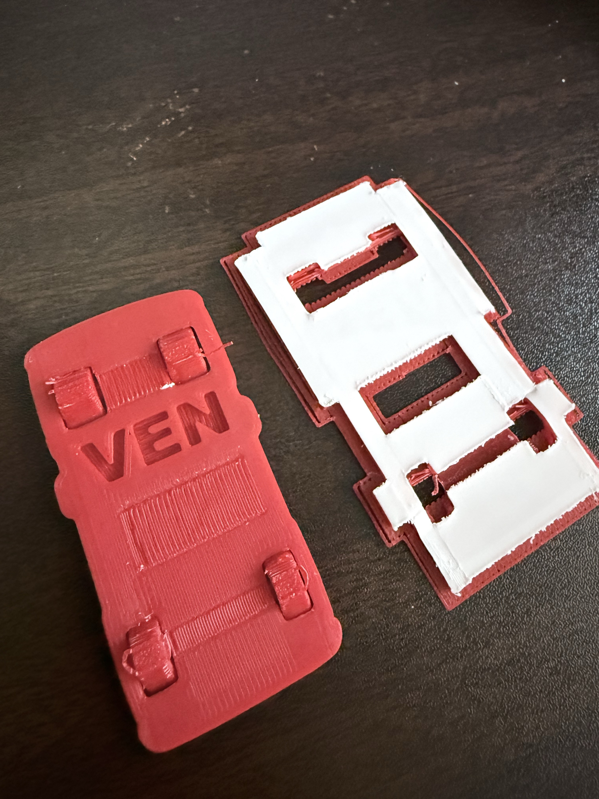

# 船・BEN・Pick-Up Bench・ローバーの調査記録

2026-11-13の調査記録。実物の破損、設計への指摘、印刷前の確認事項を分ける。BEN、Pick-Up Bench、Benchy Boatは別のモデルとして扱う。既存のTR番号は変更せず、本書では追加採番しない。

## 調査範囲と欠落

[セッション棚卸し](source-inventory.json)から、作業フォルダが `C:/Prj/NEKOMO` の担当ルート5件を確認した。特記がない時刻は日本時間。ローカルセッションが別プロセスから開かれていた2件は、Codexアプリの会話履歴で確認した。アプリから得た時刻はターン開始時刻であり、写真に写る破損が起きた正確な時刻ではない。

| チャットID | 会話の題名 | 確認した内容 |
| --- | --- | --- |
| `01a1cdb6-2370-7f92-87b5-ec4b580ce3c5` | 📝 Pick-Up Benchのタイヤ破損を不具合登録 | 検証片の破損報告、印刷対象の行き違い |
| `01a1cad2-0629-7322-9358-7c1be06ab783` | 🚤 元のBENをFreeCADで忠実に再現 | BENの外観要求、再現データ |
| `01a1cacc-1960-7f72-b59f-638b0b2b042b` | 📚 BENの造形知見を今後の設計に活用 | 3色印刷、天井のブリッジと未評価事項 |
| `01a1cb1a-7a36-72e2-8a9b-4471d813553a` | 📣 ローバーの制作時間とDR実績をX投稿画像にする | R11のデータ審査と投稿画像の時間表示 |
| `01a1d2ff-0f0d-7521-8841-5b1c066c17b6` | ⏱️ 三色の船の印刷時間を見積もり | 別の船の3MF表示、印刷時間の予測とサポート警告 |

補助確認として、作業フォルダ外 `C:/Prj` で始まった `01a1c054-10d8-7a03-a708-0c73c4221f05`「🚤 Benchy Boatの印刷可否確認」をアプリで読んだ。2026-11-09 21:41 JSTの発言は「これっていんさつできる？」で、実物の失敗報告はない。別モデルの印刷可否相談なので、BENやPick-Up Benchの不具合証拠にはしない。補足は[関連プリンター事例](related-printer-cases.md)にも記録した。

この記録は担当5件と上記の補助会話に限る。子セッションの本文はここでは調べていない。全履歴を確認したとは扱わない。既存の集約は[過去の不具合と再発防止](../../docs/過去の不具合と再発防止.md)、全体の範囲は[調査記録の入口](README.md)を参照する。

## 実物で報告された破損

### NEKOMO-TR-003 Pick-Up Bench r01のタイヤ周辺

[同じ報告の写真3枚](photos.md)も掲載しています。写真はr01検証片の破損報告で、r02の改善結果ではありません。

**症状。** 利用者はタイヤ周辺が割れた状態を写真3枚で報告した。対象は完成車ではなく、60 mm版r01から切り出した底部4 mmの検証片。

**日付。** 発生時刻は記録されていない。2026-11-13 15:11 JSTに利用者が報告し、「タイヤの下にもサポート材入れたら？バキバキです」と述べた。時刻はアプリ履歴のターン開始時刻。

**対象版。** 実際に送信したデータは[r01の `coupon-4mm-sliced.3mf`](../../designs/pick-up-bench/r01/print/coupon-4mm-sliced.3mf)。SHA-256、材料、設定、20/20層の完了状態、写真の対応は[NEKOMO-TR-003](../print-failure-20261113-pick-up-bench/過去トラ-NEKOMO-TR-003.md)と同じフォルダーの証拠に記録した。

**原因。** 未確定。タイヤ下への支持追加は利用者が出した対策案であり、支持不足が原因と確認したわけではない。破損が印刷中、プレートからの取り外し中、サポート除去中のどの段階で起きたかも未確認。

**対策と検証。** タイヤ下面の実経路、サポートブロッカー、取り外す向きと工具の差し込み位置を調べることが初回登録時の対策候補だった。初回の不具合登録ではCAD変更、再スライス、再印刷、本体印刷をしていない。スライスの `PASS_FILE_ONLY` と20/20層の完了は、破損しない造形やサポート除去の成功を示さない。写真では物理破損を確認したため、TR-003は未解決のまま保持する。

**後続r02の追補。** 2026-11-13の最終照合時には、別チャットの作業で[r02のタイヤ下支持追加](../../designs/pick-up-bench/r02/README.md)が保存されていた。形状・寸法を維持し、3層のラフトと接触距離0 mmを設定した。4輪下の界面経路をファイルで確認し、修正した4 mm検証片の送信とRUNNINGを記録している。本体は未送信で、修正検証片の完了・実物の改善・除去性は、この記録では未確認。これは後続の対策記録を確認した追補であり、今回の履歴調査では機器操作や再印刷を行っていない。

**印刷範囲の認識差。** 2026-11-13 13:41 JSTに利用者は「印刷してみて」と依頼し、15:07 JSTに「は？？トラックは？？」と確認した。プロジェクトの[造形前確認ルール](../../AGENTS.md)では、本体へ進む前に代表検証片でサポート除去を確かめる。会話では検証片だけを先に印刷し、本体は除去結果待ちと説明していたが、その後利用者がトラック本体を確認した。印刷範囲の認識差が残っていた。検証片先行はルールに沿った本体印刷の保留であり、本体の印刷実施漏れやタイヤ破損の原因とは区別する。

**再開条件。** 破損の段階と、タイヤ下面の支持・接触条件を確認する。形状や支持を変更する場合は前版を保持して新リビジョンに記録し、代表検証片で支持の除去方向、タイヤ周辺の欠け・割れ、下面を実物確認する。本体の印刷へ進む判断は検証片の実物結果と分ける。再印刷はこの調査だけを理由に開始しない。

### 破損と区別する選定要求

2026-11-12 23:01 JST、利用者は同じPick-Up Bench選定会話で「印刷後にタイヤが回るもないよ！技巧や技法がわかるやつを選んでよ！ブリッジとかです」と述べた。これはサンプル選定に対する機能・学習目的の指摘であり、Pick-Up Bench r01のタイヤ破損報告ではない。発言だけでは、回らなかった先行モデルの名前・版・実際の故障箇所を特定できない。両事例を結びつける根拠はない。

## 設計と検証に関する指摘

### BENの外観要求からの逸脱

**症状と日付。** 2026-11-12 11:05 JST、利用者は「BENをまずはFreeCADで完全再現するところからやったら？」と指示した。これは外観・設計方針への差し戻しであり、実物の破損ではない。

**対象版。** 直前の低い板状のv02/v03案は元のBENの外観を保てず、採用されなかった。原形再現の基準は[FreeCAD再現記録](../../designs/ben-original-freecad/README.md)。

**原因。** 設計案が元モデルの外観から離れたことは記録で確認できる。ユーザーの再現指示はその不一致を解消する要求として残す。

**対策と検証。** 元STLの94,376面を使った閉じたFreeCADソリッドを作成し、頂点と面の座標を小数点以下6桁まで元データと照合した。幅35 mm、長さ60.002 mm、高さ49.998 mmの再現は確認済み。ただし面ベースのソリッドで、パラメトリックモデルではない。補強、再解析、実物の強度・浮力、幼児の使用は未確認。

**再開条件。** 補強や設定変更で外観を変える前に原形との差を確認する。CADを変更した場合は、その版の断面・解析・造形データを再審査する。原形再現を強度や幼児使用の承認として扱わない。

### BENの屋根ブリッジ

**症状と日付。** 2026-11-12 09:25 JST、利用者は「これってなんで天井も印刷できてるの？断面とか見たらわかるかな？」と質問し、11:04 JSTに「水平にもくうちゅうに印刷できるってことか？」と確認した。物理的な失敗報告ではなく、印刷経路の質問。

**対象版。** 通常版BENの60 × 35 × 50 mm、赤・白・濃緑の3色印刷。

**原因と対策。** 断面と実G-codeの調査で、天井付近は既に造形された両端を足場にしたブリッジと確認した。サポートを使わず250層まで完了した実績を[ブリッジ知見](../print-knowledge/ben-roof-bridge-20261112/README.md)に記録した。天井直下の空洞幅約11.489 mmと最長のBridge線分約18.515 mmは今回の形状・経路の測定値であり、一般的な限界値ではない。線分長には足場上の部分が含まれる。

**検証の範囲。** 実機FINISH・250/250層と、サポート経路のない実スライスを照合した。天井下面の品質、実寸、浮力、水上の安定性、所要時間は未評価。[完了記録](../../designs/ben-christmas-3color/print-run-20261112/印刷完了記録.md)の09:23 JSTは完了状態の確認時刻で、実際の終了時刻ではない。幼児使用やDR0〜DR4通過も確認していない。

**再開条件。** 寸法、材料、向き、屋根形状を変えた場合は、元BENの結果をそのまま適用せず、断面と実際の経路を再確認する。下面品質や浮き方を判断する必要が生じた場合は、それぞれの実物確認を別に行う。

### ローバーR11の審査時間と投稿画像

**対象と日付。** 2026-11-12の会話 `01a1cb1a-7a36-72e2-8a9b-4471d813553a`。対象はルナ・ローバーR11のデータ審査とX投稿用画像。

**発言と表示。** 利用者は20:36 JSTに「何時間かかって、DRをいくつくぐりぬてきたのかとかも記載したhtmlにして画像で欲しい」と依頼した。応答画像には約7時間33分とDR0〜DR4のデータ審査通過を載せた。応答では7時間33分は審査作業の開始から完了までで、待機時間も含むと説明している。

**確認済みと未確認。** 投稿画像を作った当時、[R11のDR記録](../../designs/little-moon-rover-v01/candidate-r11/reviews/dr-review.md)と[README](../../designs/little-moon-rover-v01/README.md)は、DR0〜DR4をデータ審査として通過、実物印刷・性能試験は未実施と記録した。投稿画像の約7時間33分は審査作業の経過時間で、READMEの約9時間32分は別途記載されたスライサーの印刷予測。どちらも実際の印刷所要時間ではない。その後、別チャット `01a1cf9e-39e8-7720-8ea6-96ad404ea6d2` でローバーR11の白プレートを実際に印刷し、2026-11-13 01:35:41 UTCに利用者が「なんか失敗したかも！確認して」と報告した。造形不良を受けて印刷を停止した経緯は[ローバーR11白プレートの記録](solaris-workflow-cases.md)にある。後続の印刷失敗と再印刷未確認を、投稿画像作成時点の状態へ戻して扱わない。

**判定と再開条件。** この会話に実物破損はない。時間・DRの表示を使う際は、作業経過時間、印刷予測、データ審査、実物試験を分ける。R11を実際に印刷・組み立てる場合は、現物の検証結果と未解決項目を記録してから使用可否を再判断する。

### 三色の船の印刷時間予測

**対象と日付。** `01a1d2ff-0f0d-7521-8841-5b1c066c17b6`の会話。対象は[Bambu Studioで開いた三色の船の3MF](../../designs/stern-trawler-christmas/r01/print/stern-trawler-christmas.3mf)。2026-11-13 13:36 JST、利用者は「時間はどれくらいかかる？」と質問した。

**確認内容。** 応答は、画面で選ばれたP1S、積層0.2 mmの設定で10時間57分、色替え308回とするスライサー予測を示した。またサポート不足の警告と専用サポート材の未指定があり、印刷前の調整が必要と記した。これは印刷実績ではない。会話で確認できるのは3MFの色表示と予測で、実物の印刷・破損報告はない。

**原因と対策。** 物理不具合は該当しない。印刷を再開する場合は、目的のプリンターと実フィラメントを確認し、サポート警告と専用材の割当を解消してから再スライス・再見積もりを行う。調整後の所要時間も未確認のため、10時間57分を確定時間として使わない。

## 再確認の要点

- TR-003は、4 mm検証片で報告された実物破損として保持する。タイヤ下の支持不足は仮説のまま。
- BENの完了印刷、ブリッジ解析、FreeCAD再現、ローバーのデータ審査は、それぞれ実物品質や幼児使用の承認を示さない。
- Pick-Up Benchの全車印刷と検証片印刷を区別する。支持のファイル検査、印刷完了、実物での除去と破損確認も別々に記録する。
