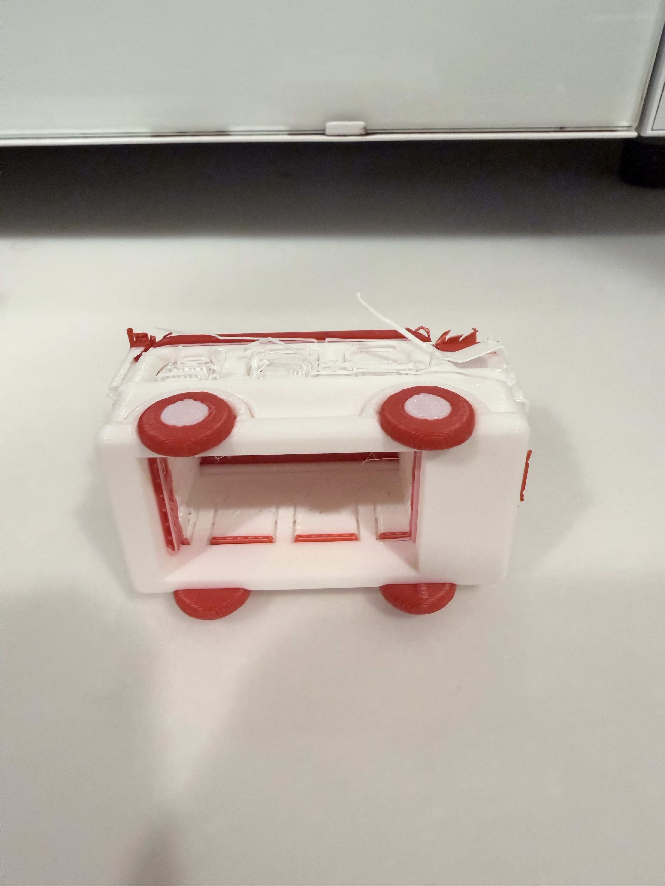
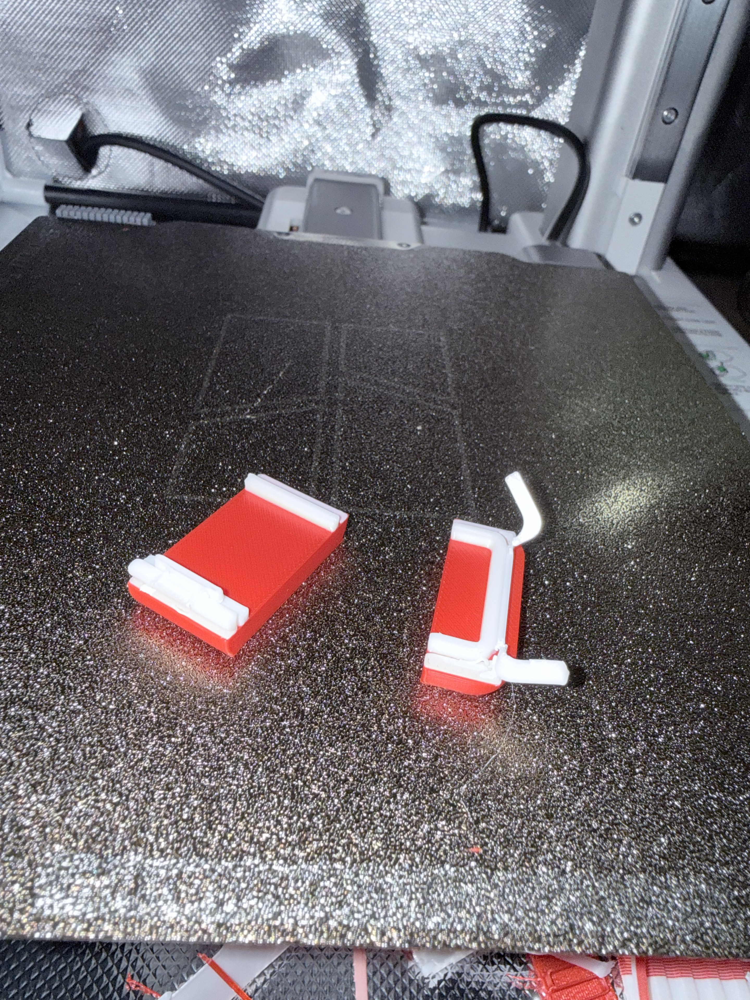

# バス設計の不具合履歴と再発防止

調査日: 2026-11-13  
対象: school-bus v01〜v13と、その派生版に関する設計・印刷・サポート除去・断面DRの記録

## 現時点で確認したこと

バスでは少なくとも2件の物理的なサポート除去不具合が発生している。1件目はv06赤タイヤ版でサポートがほぼ外れなかった事象で、既存のNEKOMO-TR-001として記録済み。2件目はv10窓・屋根検証片の窓枠がサポート除去中に折れた事象で、TR番号は付いていない。v10の破損は専用Support for PLAを接触面に使った印刷でも起きた。専用材の指定だけでは除去性を保証しない。

印刷完了、ファイル検査、FEM、現物の除去結果は別の証拠として扱う。v10の折損後に行った1 N仮定の弾性FEMは、実際の剥離荷重や破断を再現せず、強度合格を示さない。v11〜v13で形状・断面・造形データを更新したが、v10以後にサポート除去が改善した実物結果は確認できていない。

## 判定の読み方

上はv06の利用者写真です。v10窓枠破損の写真へ流用していません。[v06の写真6枚](photos.md)と[原本の対応表](photo-evidence.json)を参照できます。

| 証拠 | この記録で言えること | この記録だけでは言えないこと |
| --- | --- | --- |
| 利用者の現物報告・写真 | 利用者が報告した症状、作業中に起きたこと | 荷重、破断力、未報告の発生時刻や印刷ジョブID |
| CAD・3MF・G-code検査 | 保存ファイルの形状、材料指定、経路、スライス予測 | 実物の剥離しやすさ、仕上がり、強度 |
| 印刷機の完了記録 | 対象ジョブが機械上で完了したこと | サポート除去、寸法、強度、使用安全性 |
| FEM・断面 | 指定した形状・仮定の範囲の幾何または計算結果 | 実物の破断荷重、積層界面の剥離、未モデル化の接着・残留材 |

日付は「発生日」と「報告日」を分けた。利用者が発生時刻を伝えていない場合は、報告日時だけを確定値として記す。

## 事例1: v06赤タイヤ版でサポートがほぼ外れなかった

- 報告日: 2026-11-10。
- 発生日: 報告日前。正確な日時は未記録。
- 対象: `school-bus-v06-empty-inverted/two-color-red-tyres`。写真の赤屋根・赤タイヤ・白車体の配色はこの版と高い確度で一致するが、印刷ジョブIDによる直接照合はない。
- 状態: 実物のサポート除去NG。NEKOMO-TR-001を保持する。
- 症状: 利用者は全体にサポートが残り、「ほぼ全部が外れない」と報告。屋根端の赤い櫛状残留、窓周辺の残留、屋根面の乱れ、糸引きは同じ印刷物の別症状として扱う。

**利用者の発言。** `01a1beae-7731-7510-b683-b3c709f33730`、2026-11-10T14:28:27Z「サポート剤が取れなかったです！！どうなってるの？？」。同スレッド、2026-11-10T14:31:02Z「ほぼ全部が外れない」。2026-11-10T14:35:41Z「これを機にちゃんとサポート剤使用してほしい」。

**確認済みのこと。** 実送信3MF `red-tyres-inverted-sliced.3mf` のSHA-256は `abeb576ae657ca6edf25355696f14735eca15ae2bf9eb246b380fc9cb66381e5`。supportとsupport-interfaceはともに論理材料0で、赤・白のモデル用PLAが支持材にも使われていた。AMSに専用Support for PLAが装着されていたが、このジョブには割り当てられていなかった。G-codeには屋根端と側窓付近の支持経路がある。

**原因の確度。** 工程上の不備は確定している。専用材を接触面に指定せず、除去を代表する実物片で確認しないまま本体を印刷した。物理的な主因がPLA同士の接着、窓や屋根の狭い取り出し経路への機械的な引っ掛かり、または両方かは未確定。設定上のZ距離0.20 mmだけを単独原因とする根拠はない。写真上の屋根の乱れと糸引きもサポート残りだけで説明できない。

**実施済みの対策。** [NEKOMO-TR-001の記録](../print-failure-20261110/過去トラ-NEKOMO-TR-001.md)に、専用材の明示指定、G-codeの材料経路とAMSスロットの照合、支持の取り出し方向と工具経路の審査、代表検証片を本体より先に試す条件を記録した。[サポート除去preflight](../support-removal-preflight.py)で3MF内の界面材料経路も検査する。既存のv06実送信ファイルは`NEKOMO-TR-001`判定で停止し、支持経路のないv09ファイルは`PASS_FILE_ONLY`になった記録がある。

**検証と未検証。** 旧v06ファイルの材料指定・経路検査は不合格を検出した。専用材を使ったバスの除去成功は、この対策だけでは確認されていない。v10検証片は専用材を使ったが、次の事例のとおり窓枠が破損した。

**再開条件。** 現行版の実際の支持接触形状・材料・姿勢を代表する検証片で、専用界面材の経路とAMS割当を確認した後、工具の進入、支えの取り出し方向、窓枠と屋根端の破損有無を実物で確かめる。ファイル検査の合格だけで本体へ進まない。

関連記録: [写真レビュー](../print-failure-20261110/photo-review/review.md)、[実送信G-code調査](../print-failure-20261110/support-gcode/report.md)、[次回向けpreflight説明](../print-failure-20261110/corrective-support/README.md)。

## 事例2: 同じv06印刷物の屋根Rに乱れが見えた

- 報告日: 2026-11-10。
- 発生日: 事例1と同じ印刷物。正確な発生日時は未記録。
- 対象: v06赤タイヤ版の屋根外周。
- 状態: 写真で表面の乱れを確認した報告。単独のTR番号は付いていない。
- 症状: 屋根Rの外周に積層段差、線の離れ、波打ちが見える。糸引きとサポート残りとは別の症状として記録する。

**利用者の発言。** `01a1beae-7731-7510-b683-b3c709f33730`、2026-11-10T14:55:08Z「下にした天井のところもおかしいよね？？見た？？滑らかのRのところがへんだよね？？きつすぎた？？」。

**原因の確度。** 上下逆の造形で、平らな屋根面から外へ広がる曲面に十分な下層支持がなかった可能性が有力。半径だけが原因とは断定できず、写真から積層、局所的な支持不足、冷却や速度の寄与は切り分けていない。

**実施済みの対策。** [屋根R所見](../print-failure-20261110/屋根Rの追加所見.md)に複数断面をつないだロフト形状の所見を追加し、次のv10では天面を広げて反転時の急な張り出しを抑えた。窓・屋根片のスライス前に層間の水平拡大量をCADで調べた。

**検証と未検証。** v10の窓・屋根検証片は印刷完了したが、その後の屋根曲面品質の評価結果は確認できていない。CAD断面や層間拡大量は実物の表面品質の証明ではない。

**再開条件。** 対象版の屋根曲面を含む検証片で、接地平面と曲面外周を分けて観察し、線の離れ・垂れ・不規則な盛り上がりを記録する。窓枠のサポート除去評価とは別判定にする。

関連記録: [屋根Rへの回答](../print-failure-20261110/屋根Rへの回答.md)、[追加所見](../print-failure-20261110/屋根Rの追加所見.md)、[v10の形状・印刷データ記録](../../designs/school-bus-v10-roof-support-test/README.md)。

## 事例3: v10窓検証片がサポート除去中に折れた

これはv10の事象記録に対応する実物写真です。上のv06とは別の写真セットです。[v10の写真2枚](photos.md)を参照できます。折れた作業の段階は利用者報告によるもので、写真だけから特定したものではありません。

- 報告日: 2026-11-11。利用者が折損と作業内容を同日中に報告した。
- 発生日: v10検証片の印刷完了後、報告前。正確な日時、工具、荷重、折れた位置は未記録。
- 対象: `school-bus-v10-roof-support-test`の窓・屋根検証片。専用Support for PLAの接触界面を使ったスライスで、2片を印刷した。
- 状態: 実物の窓枠破損NG。既存の別不具合TR番号は再利用していない。
- 症状: サポートを剥がす作業中に窓枠が折れたとの利用者報告。

**利用者の発言。** `01a1beae-7731-7510-b683-b3c709f33730`、2026-11-11T13:26:38Z「折れるんだけど、なんで？？ちゃんと断面図とかで確認したり、強度計算した？？シミュレーションは？？」。同スレッド、2026-11-11T13:34:59Zの回答は「サポート材を剥がすとき」。

**発生と報告の境界。** チャットでは2026-11-10T23:00:17Zに、窓・屋根2片が104/104層で印刷完了したとアシスタントが報告した。利用者は後に破損を報告した。物理作業の正確な発生時刻は会話にない。

**確認済みのこと。** 3MF `window-roof-gfs02-sliced.3mf` SHA-256は `63850aea971f7e1c8af76ecceacef1e6f5cb184d1621e5fbca4c532da24a5bd4`。ファイル検査では界面押出1,883件すべてが論理材料3のGFS02で、本体への専用材押出は0。印刷完了は機械で確認された。これらは現物の除去性や強度の合格を示さない。

**原因の確度。** サポートを剥がす時に窓枠が折れたことは利用者の報告で確認。根本原因は未解決。接触形状への引っ掛かり、除去時の曲げ、接着、積層方向・局所形状の寄与は分離できていない。印刷前に窓枠根元の荷重審査、実測剥離荷重に基づく計算、FEMは行っていなかった。折損後の仮定1 N弾性FEMは二つのメッシュで根元応力集中を示したが、応力ピークが約26%変わり、収束を示していない。破断荷重は分からない。

**対策の進み具合。** v11で窓枠中間を内側へ厚くし、CAD実測2.4 mmから3.6 mmにした。根元は屋根とガイドが重なるため、目標3.5 mmを実断面で確認できた値として扱わない。v11で追加された根元R0.8は、後の断面レビューで柱を細くするえぐれと判明し、v12直線根元ではえぐれを埋めて柱を屋根までつないだ。v12の断面監査とFEM、v13の機能DRを経てv13 r2を作ったが、除去性は未検証のまま。

**v13 r2の現状。** CADと出力メッシュは閉じた1ソリッド。DR1は一部実施・保留、DR2 FEMは未実施、DR3はスライスとファイル経路の範囲内で適合、DR4は保留。修正した3所見に対して、断面線端点の原因、屋根・白枠の接合強度、前窓斜柱の肉厚、固定輪の保持強度の4項目が未解決。全体スライスは予測4時間38分59秒、材料切替85回。v12中央検証片の約46分を本体の予測として使わない。印刷と除去確認はない。

**再開条件。** 現在のv13 r2または後続版のCADを基準に、未解決4項目をDR1で解消し、必要な荷重経路と解析をDR2で検討する。DR3では本体と同じ位置・向き・支持経路を持つ代表片を複数箇所で確認し、GFS02経路、材料割当、工具の進入口、取り出す順序と出口を記録する。代表片の窓枠を折らずに除去できることを実物で確認してから、本体の印刷可否を別途判断する。旧版のFEMや検証片の結果を現行版へ移さない。

関連記録: [v10折損DR監査](../strength-failure-v10-20261111/dr-audit/review-record.json)、[v10支持接触報告](../strength-failure-v10-20261111/support-contacts/support-contact-report.md)、[v11変更記録](../../designs/school-bus-v11-thick-window/README.md)、[v12 FEM感度記録](../v12-section-audit-20261111/strength/report.md)、[v13 r2独立DR](../v13-functional-dr-20261111/independent-review/r2-review.md)。

## DRと証拠の取り違え

2026-11-09のv03レビュー時に、印刷前データ準備とDR完了が混同された。アシスタントは「DR0〜DR2の完了判定までは済んでいませんでした」と訂正し、要求、FMEA、試験計画を追加してv04で条件付き判定を記録した。利用者は同日「制作フローは全部やったのか」と問い、未実施の作業を完了扱いしないよう求めた。

`01a1beae-7731-7510-b683-b3c709f33730`、2026-11-09T08:19:05Z「制作フローは全部やったのか？どゆなことやったの？？」。同スレッド、2026-11-09T08:21:26Zにアシスタントは「DR0〜DR2の完了判定までは済んでいませんでした」と認めた。

DR番号は定義の版と一緒に読む。旧v1の版一覧にある段階番号を現行v2へ読み替えない。現行v2ではDR1が形状、DR2が解析、DR3が造形データ、DR4が総合判断。造形完了、ファイルpreflight、断面図、FEMのいずれも単独では実物のサポート除去や使用安全の合格にならない。[NEKOMO DR v2の定義](../../.agents/skills/nekoneko-dr-review/references/stages.md)と[バス版一覧](../../docs/バスの版一覧.md)はこの違いを記録している。

**既に実装された再発防止。** 現行DRスキルに、DR1の機能・肉厚・接続の断面確認、DR2の断面と荷重経路の照合、DR3の実スライス断面・材料経路・工具アクセス・取り出し経路を追加した。各所見について処置を記録し、同じ位置を修正後に再確認する。

**残る記録上のリスク。** [バスの版一覧](../../docs/バスの版一覧.md)は確認日が2026-11-10で、v09までの履歴と旧v1の表を掲載している。v10〜v13と、11/11の検証片印刷・窓枠折損は含まれない。v06-simpleとv06-empty-inverted、v12-straight-rootとNKM-X12A Solarisのように同じ番号を使う別分岐もあるため、番号単独で証拠をひも付けない。フルパス、分岐名、CAD・3MFのハッシュ、日付を併記する。

## バージョンと物理証拠の一覧

| 表示版・分岐 | 既存記録で確認できる内容 | 物理結果と未完了事項 |
| --- | --- | --- |
| v01 大型一体 | 大型一体固定輪。後窓の約46 mm級ブリッジを検出し検証片を準備 | 印刷なし。ブリッジ表面、強度、安全性は未確認 |
| v02 大型3部品 | 車体・屋根・底板。材料界面と各部品のスライスを確認 | 印刷なし。組立保持力と除去性は未確認 |
| v03 60 mm組立 | 赤白3部品。印刷予測約7時間26分。DR不足を検出 | 印刷なし。要求・試験計画を整備する前のDR完了表示を訂正 |
| v04 60 mm一体 | 34 mm幅の一体版。DR0〜2は成人評価用試作に限る条件付き | 印刷なし。再梱包時のCADハッシュ不一致が残り、梱包停止（[検査記録](../../docs/evidence/v04-packaging-check.json)） |
| v05 底面開口候補 | 支持材除去用の中央窓検証片を準備 | 候補本体のスライス・印刷なし |
| v06-simple 40 mm | 40×20×22 mm、単色・車内空間なし。別分岐 | 印刷なし。DR3未実施、DR4保留 |
| v06-empty-inverted 60 mm / red-tyres | 床・座席なし、上下逆、赤屋根・赤タイヤ版。通常PLA支持経路 | 実物サポート除去NG。NEKOMO-TR-001 |
| v07 40 mm床なし | 赤白・床なし・中空。サポートなしを狙う別分岐 | 印刷なし。DR3未実施、DR4保留 |
| v08 写真型 | 42×21×24 mm。ボンネット形状と支持経路を検討 | 全DRの再実施なし。印刷実績なし |
| v09 傾斜ボンネット | 42×21×24 mm。支持材なしを狙う | 印刷機のFINISH記録と利用者報告あり。下面品質・寸法・強度・使用安全は未評価 |
| v10 屋根・窓検証片 | 曲面・窓接続を修正。GFS02を接触面に指定 | 検証片2個の104/104層完了。窓枠がサポート除去中に破損。改善確認なし |
| v11 厚肉窓枠 | 窓柱中間を2.4→3.6 mmに変更 | CADのみ。スライス・印刷・除去試験なし |
| v12 straight-root | 根元のえぐれを埋め、柱を屋根まで接続。断面と1 N FEMを記録 | 細メッシュのみ完走、粗メッシュ失敗。強度判定・印刷・除去試験なし |
| v12 NKM-X12A Solaris | v09から派生した80 mm級の3色バス分岐 | CAD・スライス・ファイル経路の確認のみ。印刷・現物試験なし |
| v13 clean-interior r2 | 断面の機能レビューを経て3項目修正、4項目保留。全体スライス約4時間39分・85切替 | 印刷なし。DR1保留、DR2未実施、実物除去・DR4未完了 |

「印刷完了」は印刷機のジョブ状態を指す。v06とv10のサポート除去NGは別の物理結果であり、v09のFINISH記録はどちらの除去性も証明しない。2026-11-10時点の版一覧にある「印刷済み2件」はその日付時点の記録であり、11/11に行ったv10検証片の印刷を含む総数ではない。

## チャット調査記録

この調査は、ローカルrollout JSONLの先頭`session_meta.payload.cwd`が`C:\Prj\NEKOMO`と完全一致するセッションを対象にした。親が作成した`source-inventory.json`の基準時刻は2026-11-13T06:12:06.874Zで、root 20件・child 197件。件数には挿入されたユーザーコンテキストが含まれるため、発言数や人間のレビュー件数としては使わない。

### バス設計に関する確認済み主スレッド

| チャットID | 読んだ範囲 | 事例・事実に使った内容 |
| --- | --- | --- |
| `01a1beae-7731-7510-b683-b3c709f33730` | 2026-11-09T05:01:10Z〜2026-11-11T16:12:20Z。user/assistantの会話本文を最後まで確認。指示注入、環境情報、ツール呼び出しは会話根拠に含めない | v01〜v13の経緯、v06サポート除去NG、v10検証片の印刷後に窓枠が折れた報告、v11〜v13の断面DRと未確認事項 |
| `01a1bff5-87cc-7113-a4dc-2c4cb667134d` | 2026-11-09T10:58:23Z〜12:06:26Z。user/assistant会話の小型化・v06-simple・v07に関する範囲 | v06-simple 40 mm案とv06-empty-inverted 60 mm案は別分岐。v07は床なし・逆さ・赤白・サポートなしを目指したデータ検討で、印刷はしていない |
| `01a1c003-f9a9-7d20-8e42-eccfcbd6749d` | 2026-11-09T11:14:10Z〜11:35:29Z。user/assistant会話の3DBenchy比較・小型バス案 | Benchyサイズのバスを探す要望と、配布3MFを取得できず時間未確認の経緯。後続のバス設計・印刷結果とは区別 |
| `01a1c01f-e639-7d33-bd15-bcd64a2fff78` | 2026-11-09T11:44:42Z〜20:19:52Z。user/assistant会話のv08・v09設計、印刷開始・進捗・完了 | v09は支持材なしのスライス後に印刷完了（119/119層）。写真仕上がり・寸法・強度・使用安全の評価は別で、v06やv10の除去成否を示さない |
| `01a1c51a-7f2f-77b3-a133-c2c868770a84` | 2026-11-10T10:56:54Z〜2026-11-11T04:27:00Z。user/assistant会話から、版ごとの人間レビュー、印刷状態、DR、v06不具合を照合 | 利用者は2026-11-10T13:08:12Zに「印刷したのは2つです」と当時の報告。これは同日時点のv06・v09に関する情報で、11/11のv10検証片を含む現在の累計に流用しない。v06 NGとv09 FINISHも別証拠 |

以下の関連ルートは主スレッドとは分ける。`01a1cacb-987e-7612-a47b-152e856122fd`はSOLARIS派生の詳細履歴で、別調査の[報告書](solaris-workflow-cases.md)がR06の追補まで扱う。本稿ではその枝の長いDR2解析をバスv01〜v13本流の物理試験数・強度判定に混ぜない。`01a1cacc-1960-7f72-b59f-638b0b2b042b`はBENのブリッジ知見、`01a1cad2-0629-7322-9358-7c1be06ab783`はBENのDR、`01a1cb1a-7a36-72e2-8a9b-4471d813553a`は別企画の画像、`01a1cd78-f840-7c02-8520-2287fc1a4fba`はSolarisの印刷依頼であり、バス本流の実物結果には数えない。

### 欠落と制約

- v06の写真と印刷ジョブIDは直接対応していない。版の一致は配色と保存資料からの高確度判定である。
- v10窓枠破損の発生時刻、正確な破断位置、工具、剥離荷重、実AMS割当と印刷ジョブの直接対応は記録されていない。
- v10以後の専用材による実物除去成功は確認できていない。
- rollout棚卸し全体はroot 20・child 197件だが、子スレッド全件の会話本文を本稿の担当範囲として読んだとは扱わない。上表の5主スレッドの関連user/assistant発言、本文から特定した関連の保存記録、および別担当のSolaris報告を根拠にした。全てのツールイベント・環境注入・無関係な公開作業メッセージは事例証拠に含めていない。
- v10〜v13のDR数値と各段階の判定は、この報告内でリンクした既存の個別記録に照合した。CAD・製造・印刷は今回実施していない。
