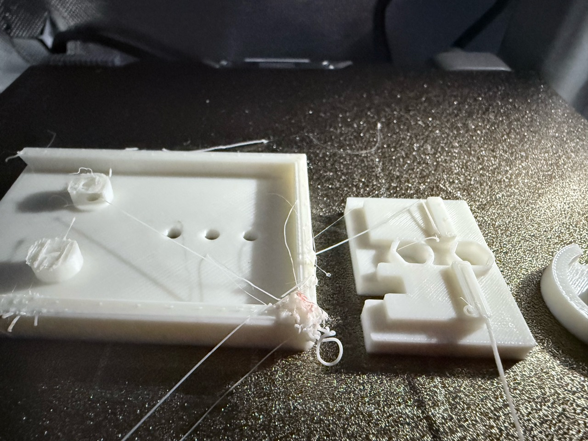

# ソラリスとローバーの造形・開発記録

2026-11-13の調査記録。チャット発言と保存された設計・造形記録を照合した。本文中の参照番号はこの文書内だけの番号で、正式なNEKOMO-TR番号ではない。既存のTR番号は変更していない。

## 調査範囲

| チャットID | 調査した範囲 |
| --- | --- |
| `01a1cacb-987e-7612-a47b-152e856122fd` | SOLARIS R00/R01の要求、記録、造形計画、DR作業と長時間化に関する発言 |
| `01a1cd78-f840-7c02-8520-2287fc1a4fba` | R01本体の印刷開始判断と、印刷前に残った確認事項 |
| `01a1cdac-85e0-7d90-ae7c-45fb2ff126e8` | 修正前後の保存場所とリビジョン記録の指示・訂正 |
| `01a1cf11-0be0-72e1-afe1-15a0895d8f81` | SOLARISを含む長時間化の調査依頼と報告 |
| `01a1cf9e-39e8-7720-8ea6-96ad404ea6d2` | ローバーR11の印刷、白プレートの不良、中止、移動後の再キャリブレーション |

上記は作業フォルダ一致のセッションメタデータを確認したうえで、該当するuser/assistant発言と必要な保存記録を調べた。子セッション全197件の本文をすべて読んだという意味ではない。SOLARISの解析遅延は[既存の所見](../../outputs/delay-investigation/solaris-findings.md)を参照し、同ファイルに明記された2026-11-12 09:34:19 UTCの締め時刻を超える状態は推定していない。ただし追補として、担当チャット`01a1cacb-987e-7612-a47b-152e856122fd`の2026-11-13 06:29:33 UTCの最終回答と、保存済みR06 DR記録を確認し、事例2へ明示して追記した。この追補は調査開始時点のルート20・子197件の棚卸し件数に加算していない。チャットの発言時刻はUTCで示す。

**判定の要約。** 実物の造形不良として確認できるのはローバーR11の白プレートです。SOLARIS R01の停止はサポートを実物で外せるか未確認だったための印刷前保留です。SOLARISの論理材料番号とプリンターの物理AMSスロットの不一致は見つかっていませんが、印刷前に物理割当を確認した記録もありません。移動後の再キャリブレーションは完了しましたが、造形不良の原因が校正だったとは確認できていません。

## 事例1. SOLARISのリビジョン保存と記録方針

- **症状。** 変更前後の保存方法をAIが一度取り違え、利用者が求めたリビジョン別フォルダではなく、変更ごとのbefore/afterフォルダとして解釈した。過去版そのものが失われた証拠はない。
- **発生・報告。** 2026-11-11 15:39 UTCまでに80 mm仮案のR00を作成した。利用者は2026-11-11 15:53:47 UTCに「60mm前後」と指定し、15:54:17 UTCに「それぞれのDRした内容・修正した内容とかもちゃんと記録しておいてね！」と求めた。R00から60 mmのR01へ改訂する作業が続いた。
- **対象。** `NKM-X12A SOLARIS` R00（80 mm仮案）とR01（60 mm改訂）。
- **証拠。** チャット `01a1cacb-987e-7612-a47b-152e856122fd`、2026-11-11 15:53:47 UTCの利用者回答と15:54:17 UTCの記録要求。[R00 CAD](../../designs/school-bus-v12-evolution/cad/NKM-X12A-R00.FCStd)、[R01 README](../../designs/nkm-x12a-solaris-r01-60mm/README.md)、[要求記録](../../designs/nkm-x12a-solaris-r01-60mm/user-requirements.md)、[変更判断一覧](../../designs/nkm-x12a-solaris-r01-60mm/decisions.tsv)。保存方針のやりとりはチャット `01a1cdac-85e0-7d90-ae7c-45fb2ff126e8`、2026-11-12 02:53:22 UTC「修正前後のデータは残すようにして」と02:56:53 UTC「リビジョンのフォルダとかでしょ？？」。
- **原因。** R00を80 mmで作成した後に60 mmの要求が確定した順序は記録上確認できる。要求寸法を確定する前に作業を進めたことが改訂作業を増やした、という評価は経緯からの推定で、利用者の責任とは扱わない。記録場所の取り違えはAI側の解釈違いであり、データ消失ではない。
- **対策。** R00を残したままR01を作り、R01に要求・判断・DR・造形データをまとめた。利用者の訂正後、保存方針は `designs/<開発コードネーム>/r00/`、`r01/` の版別フォルダへ改められた。[設計変更の記録ルール](../../docs/design-change-records.md)と現行[AGENTS.md](../../AGENTS.md)に記録要件がある。
- **検証・未確認。** R01のREADMEと変更一覧からR00とR01を区別できる。過去のファイル消失は確認されていない。寸法を確定する前の作業を避けた場合の所要時間短縮量は測定していない。
- **再開条件。** 追加変更は新しいリビジョンに保存し、前版・変更理由・差分・検証状態を維持する。過去データの欠落が見つかった場合は、欠落として記録し、再生成物を当時の実データに置き換えない。

## 事例2. SOLARISの長時間化とDR2解析の再作業

- **症状。** 設計・解析・DR修正の反復で作業が長時間化した。単なる計算待ちだけでは説明できない解析入力の問題が報告されている。
- **発生・報告。** 利用者はチャット `01a1cf11-0be0-72e1-afe1-15a0895d8f81` の2026-11-12 09:22:47 UTCに「でメチャ時間かかってます なんで？」と質問した。2026-11-12 11:17:13 UTCの報告は、SOLARISの解析条件がメッシュごとに変わり、R05の荷重面にも再解析前の修正が残ったと整理した。
- **対象。** `NKM-X12A SOLARIS` のR02〜R05を含むDR2解析作業と、後続のR06 qualification状況。遅延所見自体の締め時刻は[所見](../../outputs/delay-investigation/solaris-findings.md)に記載された2026-11-12 09:34:19 UTC。
- **証拠。** `01a1cf11-0be0-72e1-afe1-15a0895d8f81`、2026-11-12 09:22:47 UTCの利用者質問と11:17:13 UTCの報告。[SOLARIS遅延所見](../../outputs/delay-investigation/solaris-findings.md)はメッシュごとの荷重パッチ面積15.8288、15.6190、15.0948 mm²、座標閾値による拘束選択、重心近似による材料領域分類の変動を記録している。[調査レポート](../../outputs/delay-investigation/report.html)には時間内訳と集計範囲がある。追補として、同ルートチャット`01a1cacb-987e-7612-a47b-152e856122fd`の2026-11-13 06:29:33 UTCの最終回答は、300秒診断と24出力ファイル保存、代替ビルド停止原因の特定および修正版r02の作成・検証を報告し、強度解析・物理確認は未実施、印刷なしとしている。[保存済みR06記録](../../designs/nkm-x12a-solaris/r06-spatial/README.md)も照合した。
- **原因。** 既存のソース調査では、荷重・拘束・材料領域の選択がメッシュ間で一定でなく、収束比較を妥当に行えない構造が見つかった。これは解析実装の問題として記録されている。寸法未確定のまま80 mmのR00を進めたこと、数値解析と全DRの範囲へ作業が広がったことも時間の要因として挙げられているが、寄与時間は個別に測定されていないため推定として扱う。
- **対策。** 比較条件の修復、解析の再実行、R04からR05への形状改訂が進められた。これは完了証拠とは分ける。締め時点ではR04の全体応答が基準内でも局所ピークが不通過で、R05はスライス検査の後、解析入力の確認・再解析・総合DR判定が残っていた。
- **後続R06で判明した別の実装・検査不具合。** 以下は同じ開発ルートの保存履歴から確認した。R06 READMEの作成日は2026-11-12だが、試作の個別発生時刻は記録されていない。

  | 対象 | 症状と確度 | 対応と残件 |
  | --- | --- | --- |
  | R06最初の丸め試作 | R05のBEN型空洞生成ヘルパーを使わず、R05形状を表さない候補になったため不採用。 | 試作を`attempts/`に保持し、R05ヘルパーを使う形状を作り直した。保存形状の比較は済んだが、強度・造形結果を示さない。[R06記録](../../designs/nkm-x12a-solaris/r06-spatial/README.md) |
  | ゼロcap比較の初回検査 | 空のCompoundを不一致とする検査式の誤判定。 | 初回記録を保持し、判定式を修正した別記録で比較を再確認。[R06基準形状比較](../../designs/nkm-x12a-solaris/r06-spatial/attempts/baseline-check-attempt02/evidence/baseline-comparison.json) |
  | A11解析パイプライン v1〜v6 | v1〜v5はreportがERRORでsolver開始0件。停止は順にresource guard参照、展開後入力SHA、`FIXED`入力の欠落、診断キー参照、`h_mm`欠落。v6は粗メッシュ2ケースの結果後、中格子ケースが2400秒で停止。 | v1〜v6の失敗記録を保持。粗メッシュ部分結果は全ケース・収束・GCIの合格を示さず、中格子timeoutも形状不良の証拠ではない。[R06記録](../../designs/nkm-x12a-solaris/r06-spatial/README.md) |
  | 代替solver A16 r00 | イベント記録関数の`name`引数を重複して渡し、`TypeError: append_event() got multiple values for argument 'name'`で停止。solver・mesh/FEAはいずれも実行0件。 | r01でイベント種別の引数名を`event_name`へ変更した。r00の停止記録は保持し、r01の準備や後続実行をr00の成功へ置き換えない。[r00の失敗記録](../../designs/nkm-x12a-solaris/r06-spatial/qualification/a16-pastix-build/r00/output-v1/nekomo-a16-pastix-build/build-only-report.json)、[引数の修正記録](../../designs/nkm-x12a-solaris/r06-spatial/qualification/a16-pastix-build/r01/README.md) |
  | 代替solver A16 r01以降 | r01のconfigureがnative build前に停止。Python 3.13.18で削除済みの`imp`を生成用Pythonスクリプトがimportし、失敗を止めずに空の生成物をCMakeへ渡して`No SOURCES`になった。実際のBLAS選択も意図したOpenBLASでなくMKLだった。 | r02の互換性パッチと明示的ツール・ベンダー設定が保存されたが、recipeは`STATIC_SOURCE_COMPATIBILITY_PATCH_PREPARED_NOT_BUILT`。native build・solver実行は未検証。r02の状態はbuild recipeを根拠とし、古い版のREADMEから推定しない。[根本原因監査](../../designs/nkm-x12a-solaris/r06-spatial/qualification/parent-review/solver-scalability/a16-r01-cmake-root-cause-D01.json)、[r02 build recipe](../../designs/nkm-x12a-solaris/r06-spatial/qualification/a16-pastix-build/r02/build-recipe.json) |
  | A17 300秒診断 | A11入力が報告上のfactorization段階まで進み、300 resource samplesと24成果物を保存。単一の計測診断で、全中格子解析や性能比較ではない。 | 記録・hash監査は済んだが、medium caseの完了、性能限界、速度改善は未確認。[終端監査](../../designs/nkm-x12a-solaris/r06-spatial/qualification/parent-review/a17-r01-profile-terminal-audit-D01.json) |
- **検証・未確認。** [最新の保存済みR06記録](../../designs/nkm-x12a-solaris/r06-spatial/README.md)では個別項目73/88がPASS、DR2・DR3・DR4の段階ゲートと全体ゲートは未通過。fine格子、6 primary全体、repeat、GCIは未完了で、物理確認はNOT_RUN、印刷は未実施とされる。後続のチャット最終回答は診断出力と代替ビルド修正の報告であり、これらの未通過状態を解消した根拠にはならない。
- **再開条件。** DR2を続ける場合は、各メッシュで荷重面、拘束領域、材料領域が同じ条件になることを検査し、修正後の入力・平衡・収束結果を再確認する。R05の荷重面とsolver入力も確認し、未通過の局所応答を解決してから総合判定を更新する。

## 事例3. SOLARIS R01の印刷前保留と材料番号の区別

- **症状。** ファイル内の専用サポート材割当は確認できたが、代表的な検証片で実物のサポートを除去できた証拠と、送信時点の物理AMS割当がなかった。
- **発生日・報告日。** 実物の不具合は発生していない。利用者はチャット `01a1cd78-f840-7c02-8520-2287fc1a4fba` の2026-11-12 01:57:03 UTCに「これでいけそうなら印刷開始して」と依頼した。
- **対象。** SOLARIS R01の本体3MFと窓・ボンネット周辺のC02検証片。
- **証拠。** 同チャットの01:59:02 UTCに、本体印刷を開始せず保留したと報告した。[造形計画](../../designs/nkm-x12a-solaris-r01-60mm/manufacturing-plan.md)は本体・検証片のpreflightを`PASS_FILE_ONLY`としつつ、プリンター接続、物理AMS材料の読取り、実物の除去確認、アップロードはいずれも未実施と記録する。[R01 README](../../designs/nkm-x12a-solaris-r01-60mm/README.md)には実G-codeの支持位置と除去案がある。
- **原因・リスク。** 実物不良の原因ではない。サポートが狭い窓や屋根端に引っ掛かる可能性、工具が届かない可能性を検証片で評価していなかった。ファイル検査合格から実物での除去成功は導けない。
- **材料割当。** プロジェクト内の材料1〜3は本体色PLA、材料4はGFS02 Support for PLAで、G-codeではT3に相当する。これらは論理番号で、物理AMSスロットではない。R01の送信直前に実物AMSを読み直した記録はなく、誤った物理割当が起きた証拠もない。
- **対策。** 印刷前の保留を維持し、検証片の実物除去と物理AMSの再読取りを本体造形前の条件にした。C02のCAD・スライス比較はあるが、実物での除去結果はない。
- **検証・未確認。** 3MF/G-codeの界面材料と本体への専用材非混入はファイル上で確認済み。実物AMS、スプール、工具のアクセス、窓柱や屋根端を欠かずに外せるかは未確認。R01本体もC02も印刷されていない。
- **再開条件。** まず代表する検証片で物理的な除去を確認し、実送信時のAMSスロットとプロジェクト材料番号を対応づける。その後に本体へ進むか判断する。`PASS_FILE_ONLY`だけで再開しない。

## 事例4. ローバーR11白プレートの実物造形不良

[同じ報告の写真4枚](photos.md)を掲載している。CAD予想図やG-code図とは区別した実物の写真である。

- **症状。** 白プレートのCabinRoof周辺で線状の樹脂がプレートと他部品へ伸び、2つのcaptive-nut boss上面が荒れ、屋根角に樹脂の塊ができた。白プレート全体の崩壊ではない。
- **発生日・報告日。** 印刷開始は2026-11-12 23:29:05 UTC。実際に異常が始まった時刻は記録から特定できない。利用者の初回報告は2026-11-13 01:35:41 UTC「なんか失敗したかも！確認して」。01:37 UTCに46%、47/225層で一時停止した。利用者は03:46:43 UTCに4枚の写真を添えて「これが原因です」と送った。
- **対象。** `little-moon-rover-v01/candidate-r11` の白プレート。送信記録では実スプールA1の白PLAを割り当て、印刷ファイルは`white-plate-sliced.3mf`、SHA-256 `764dca053048cae3fcb40c68baa0cca42725739a3e1980b2b3dd8f604b128a61`。このプレートでは支持材を使用していない。
- **証拠。** チャット `01a1cf9e-39e8-7720-8ea6-96ad404ea6d2` の01:35:41、03:46:43 UTCの利用者報告と、01:37 UTCの一時停止記録。[白プレート写真レビュー](../../output/rover-print-20261112/photo-review-20261113/report.md)、[失敗時の状態記録](../../output/rover-print-20261112/white-failure-facts.txt)、[白プレート送信記録](../../output/rover-print-20261112/white-dispatch-record.json)。
- **原因。** 写真とG-codeの照合では、captive-nut bossを閉じるlayer45・build Z=7.24 mmに、前層から離れたOverhang wall経路があり、boss上面の荒れと位置・時期が合うため有力候補とされた。ただし、層間接着やビード形状は中心線距離だけでは確定できない。屋根角の樹脂塊や長い線が同じ経路で生じた証拠はなく、糸引き・剥離・形状由来の寄与も切り分けられていない。原因は未確定。
- **対策。** 異常を検知して一時停止し、利用者の中止指示後に白プレートを中止した。緑プレートは送信せず、再開・再印刷もしていない。写真とG-codeの位置照合を別記録へ保存した。
- **検証・未確認。** 実物に造形不良が生じたことはカメラ映像と写真で確認された。ノズル流量やノズル状態、キャリブレーション、幾何・支持経路のどれが全症状を起こしたかは未確定。改善したことを示す再印刷結果はない。
- **再開条件。** 直近の利用者指示は中止であり、再印刷は許可されていない。形状・G-code上の候補原因と機器状態を分けて調べ、変更後のファイルを新しい版として保存し、再印刷について新たな指示があるまで停止する。

## 事例5. 中止ツールの応答エラーと実機停止状態

- **症状。** `cancel_print`は10秒以内にプリンターから応答を得られず、ツールとしてはエラーを返した。一方、実機状態の取得では白プレートが`FAILED`、47/225層、ノズルとベッドの目標温度が0℃だった。
- **発生・報告。** 利用者は2026-11-13 03:42:46 UTCに「中止してほしい」、03:43:02 UTCに「熱いので中止してね」と指示した。03:43:10 UTCの報告では、停止命令の応答中にプリンター接続が切れた。03:44:08 UTCには実機状態を再確認した。
- **対象。** ローバーR11白プレートの中止操作。
- **証拠。** チャット `01a1cf9e-39e8-7720-8ea6-96ad404ea6d2` の03:42:46、03:43:02、03:43:10、03:44:08 UTCの発言。[中止結果](../../output/rover-print-20261112/cancel-result.json)にはツールの10秒応答タイムアウトと、別項目として実機の`FAILED`状態、layer47/225、ノズル目標0℃・実温度72.375℃、ベッド目標0℃・実温度61.0625℃が記録されている。
- **原因。** 確認できるのは、停止命令が期限内に応答を得ず、MQTT接続が閉じたこと。停止命令の応答エラーだけでは、実機が動作を続けていたかは判断できない。
- **対策。** 接続を復旧して実機状態とヒーター目標温度を確認した。実際の目標温度は0℃だったが、部品はまだ冷却中だったため、触れないよう案内した。
- **検証・未確認。** 実機状態の再取得では停止・冷却を確認した。ツールの応答エラーが残った理由を機器側・接続側で分ける追加調査はない。実温度は停止直後に0℃へ下がるものではない。
- **再開条件。** 印刷は再開しない。停止操作のエラー時はツール応答だけで成否を決めず、実機の状態と目標・実温度を確認する。

## 事例6. 移動後の再キャリブレーションと原因の未確定

- **症状。** 印刷中に不良が見つかった後、利用者はキャリブレーション場所からプリンターを移動したと報告し、再キャリブレーションを依頼した。
- **発生日・報告日。** プリンターを移動した実時刻は記録されていない。利用者は2026-11-13 04:03:15 UTCに「キャリブレーションした場所から移動した」と報告し、04:04:51 UTCに「再キャリブレーションして」と依頼した。再キャリブレーションのライブ記録は04:21:29 UTCに`FINISH`、100%、エラー0を示す。
- **対象。** Bambu Lab A1 mini。振動補正とベッドレベリング。
- **証拠。** チャット `01a1cf9e-39e8-7720-8ea6-96ad404ea6d2` の04:03:15、04:04:51、04:36:52 UTCの利用者発言。送信命令の記録は[再キャリブレーション要求](../../output/rover-print-20261112/recalibration-20261113.json)、完了状態は[ライブ記録](../../output/rover-print-20261112/recalibration-live.json)、値の比較ができなかった説明は[回答記録](../../output/rover-print-20261112/calibration-values-reply.md)。
- **原因。** プリンターの移動で振動条件が変わり、校正が不良に関係した可能性はある。ただし、移動前後の補正値が保存されておらず、形状・ノズル状態など別の候補も残る。再校正後の完了だけで白プレート不良の原因を校正と確定できない。
- **対策。** 移動後の設置場所で振動補正とベッドレベリングを実行し、ライブ状態の`FINISH`、100%、エラー0を記録した。再印刷はしていない。
- **検証・未確認。** 校正コマンドの成功とライブ完了はそれぞれ確認できる。最初のコマンド記録だけは状態`IDLE`で終わるため、それ単独では校正完了の根拠にしない。校正前後の振動補正値・ベッド各点の値は保存されていない。再校正後に印刷品質が改善したかも未確認。
- **再開条件。** 校正は現在の設置場所で完了しているが、造形不良の原因は未解決で、再印刷も未承認。再印刷を判断する前に形状・G-codeと機器状態を別々に評価し、次回校正では取得可能な前後値を保存し、取得できない項目は欠落として記録する。

## 残る確認

- SOLARIS R01は、代表する検証片でサポートを除去できた実物記録がない。物理AMS割当も送信直前に確認されていない。
- SOLARIS遅延所見自体は2026-11-12 09:34:19 UTCで締められている。同時刻より後の進捗はその所見だけからは確定できず、追補したR06状態は事例2を参照。
- ローバーR11白プレートは実物の失敗が確認されたが、症状全体の原因と再印刷後の改善は未確認。再印刷は行われていない。
- 移動後の校正はライブ状態で完了した。前後の補正値を比較する記録は残っていないため、校正が不良を直したとは判断できない。
