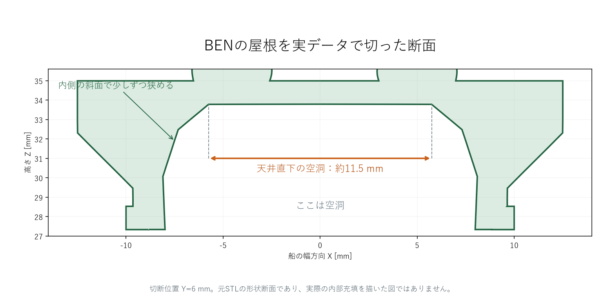

# BENの天井から得たブリッジ造形の知見

2026年11月12日記録。A1 miniで、BEN本体をサポートなしで最後まで印刷した実績と、その形状・印刷経路を対応づけた記録です。

## 次の設計で使う判断

短い隙間の両端に既存の造形部分を足場として使える場合、水平にも樹脂の線を渡せます。これをブリッジと呼びます。線を冷却し、その上へ次の層を重ねます。通常のFDMでは、足場のない空中で独立した部品を作り始めることはできません。

天井や窓の上部については、柱や壁の位置、屋根内側の斜面、各層が直前の層へつながる部分を断面で確認します。斜面で空洞を狭める形は、最後に橋渡しする区間を短くする案として検討できます。平らな天井にもブリッジが使える場合がありますが、長さ・材料・冷却・速度・要求する下面品質で結果が変わります。

サポートなしの設定や、スライサー警告がないことだけで、造形成功や仕上がり良好とは判定しません。今回の数値を、他の形状や材料でも使える最大値にはしません。

## 今回の確認値

| 項目 | 確認した内容と範囲 |
| --- | --- |
| 形状 | BEN通常版、全長約60 × 幅35 × 高さ50 mm。元メッシュを保った3色版 |
| 屋根内側 | 斜面で空洞が上へ向かって狭くなる |
| 天井直下の空洞幅 | STLのY=6 mm断面、Z=33.78 mmで11.489124 mm。この位置の幅であり、全体の最大値ではない |
| 印刷経路 | 屋根付近のZ=31.2、34.0、34.2 mmに正の押出を伴うBridge経路 |
| 最長直線経路 | 屋根付近のG1 Bridge線分は約18.515 mm。足場上の部分を含み、空中の未支持区間の長さではない |
| 印刷条件 | A1 mini、0.4 mmノズル、PLA、層高0.20 mm、壁2周、内部充填15％、船底を下に配置 |
| 材料割り当て | 赤PLA=A3、白PLA=A1、濃い緑PLA=A4。Support for PLAのA2は未使用 |
| 生成サポート | 本体のスライスにサポート経路・接触界面経路ともに0件 |
| 印刷結果 | ユーザーの完了報告と、同じジョブの実機FINISH・100％・250/250層で確認 |

図はSTLの形状断面です。実際の15％内部充填や、印刷後の実物を切断した写真ではありません。

## 未評価の範囲

天井下面の垂れ量・表面品質、窓の細部、実物寸法、浮き方と安定性、実際の材料消費量・所要時間は未評価です。正確な終了時刻も取得していません。完了状態を確認した09:23:23 JSTを、印刷終了時刻とは扱いません。印刷完了から子どもの使用可やDRの通過判定を導きません。

先行する検証片は印刷せず、ユーザーの指示で本体を印刷しました。この記録を新たな印刷や再送信の許可にはしません。支持材が必要な別の形状には、既存の専用Support for PLAと除去確認の条件を適用します。

## 設計審査での参照順

1. 比較対象の形状・縮尺・材料・造形姿勢と、今回の条件の差を確認します。
2. 重要な断面で、既存の足場と、空洞を渡す部分を特定します。
3. 前の層と次の層の実経路を確認し、ブリッジ・張り出し・足場のない孤立部分を区別します。
4. 断面の空洞幅、経路の全長、実際の未支持区間を混同せず、必要な実物確認を判断します。

## 証拠と元データ

- [断面の測定値](section-findings.json)と[Bridge経路の抽出値](roof-bridge-measurements.json)
- [印刷完了イベント](completion-record.json)と[実機の完了状態](completion-status-20261112.json)
- [元モデルの作者・出典・ライセンス](source-provenance.json)
- [モデル別の解説と再生成スクリプト](../../../designs/ben-christmas-3color/roof-explanation/天井の断面解説.md)

元モデルの作者はvandragon_deです。元ZIPはCC BY-NC-SA 3.0、作者のPrintables資料は4.0を示しています。両方のライセンス表記を出典記録に残しています。

## チャットからの再利用指定

2026年11月12日、ユーザーはチャット `01a1cacc-1960-7f72-b59f-638b0b2b042b` の知見を今後の作業にも活用するよう指定しました。このチャットは本記録の元となるBENの印刷・断面調査の会話です。

天井や窓上部の設計では、最初に足場・断面・各層の経路を確認し、ブリッジや内側の斜面でサポートなしにできる可能性を検討します。BENの印刷実績と条件の差を確認して判断し、空洞があるという理由だけでサポート必須とはしません。サポートが必要と判断した場合は、既存の専用材・除去確認の手順を適用します。
