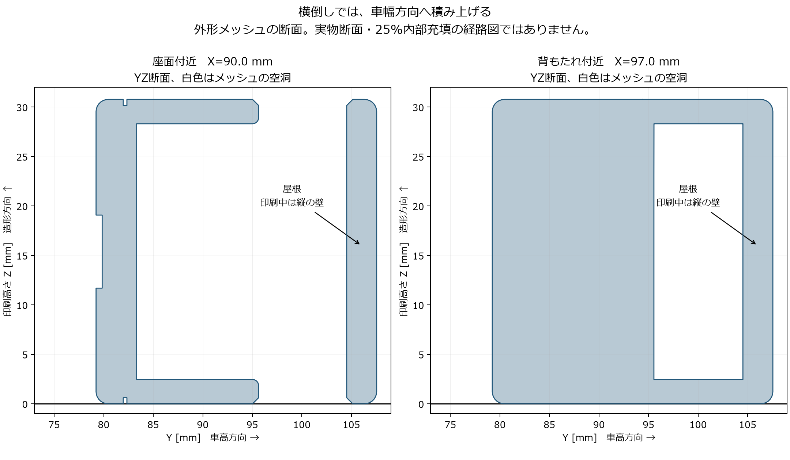
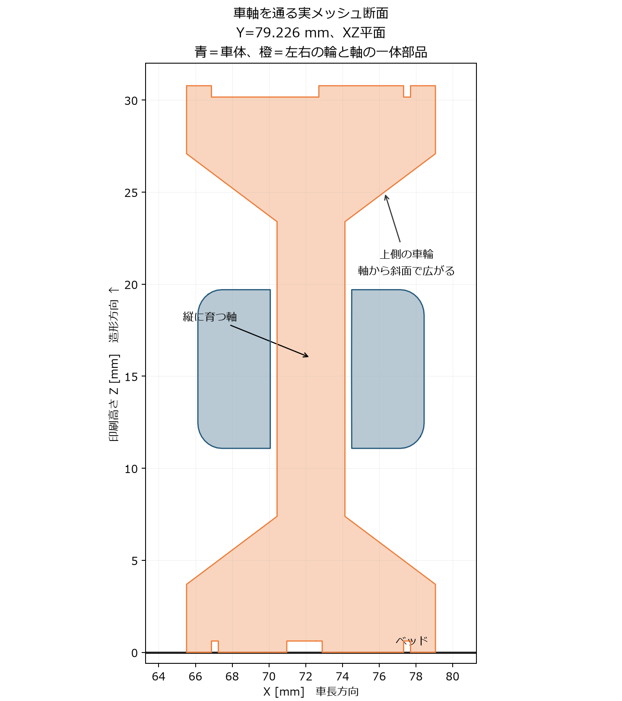
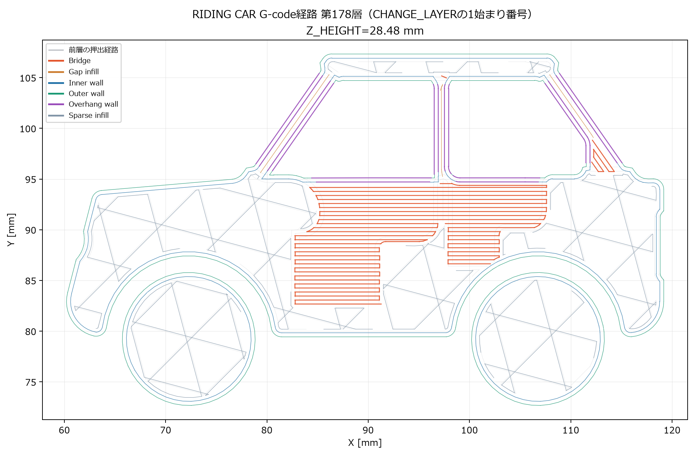
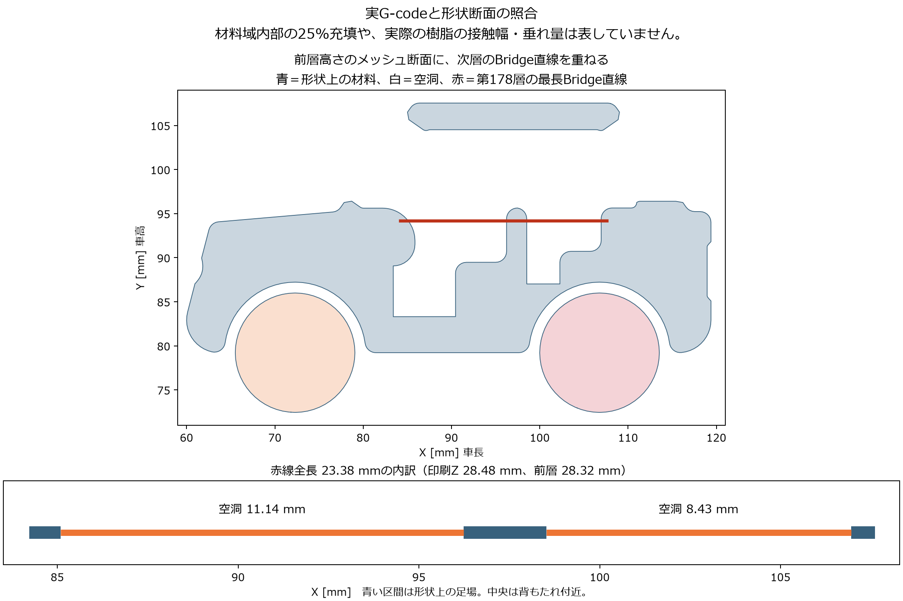

# RIDING CARのサポート不要構造の分析

2026年11月14日。対象はJaKubina作「Riding Car Model - Toy for Kids - One piece print」の60 mm版。実物写真と利用者の印刷完了報告を受け、印刷姿勢、形状断面、スライス経路を照合する。

## 対象と証拠

| データ | 役割 | 制限 |
| --- | --- | --- |
| `input/Car_Toy_Model_Interior_Bam_60mm.3mf` | Downloadsから複製した設定付き形状データ | G-codeを含まない |
| `input/studio-cache.3mf` | Bambu Studioの一時保存にあったスライス済みデータ | 実機へ送信したジョブとの直接照合は未確認 |
| `input/studio-cache-192layers.gcode` | 一時保存のG-code | 上記3MFの埋込G-codeとバイト一致 |
| `reslice/analysis-resliced.3mf` | 今回の比較用再スライス | 当時送信したデータとは扱わない |

原本のパス、SHA-256、作者のメタデータは[provenance.json](provenance.json)に保存した。キャッシュの192層、最高Z=30.72 mm、材料18.65 g、長さ6.15 mは添付のスライス画面と一致する。所要時間は見積もりであり、実測値ではない。

形状や材料、造形方向は変更していない。再スライスは解析の比較に限り、印刷送信・開始は行っていない。本記録は構造の説明で、製品全体のDR通過判定ではない。nekomo-dr-reviewの断面レビュー方法を適用するが、DR0〜DR4全体の審査は実施していない。

## 確認した印刷条件

実キャッシュの設定はA1 mini、0.4 mmノズル、PLA Basic、層高・初層とも0.16 mm、外周2周、内部充填25%、Textured PEI Plate、サポート無効。ブリッジ速度設定は50 mm/s。設定値と各経路での実際の命令を区別する。

[preflight-results.json](preflight-results.json)には、キャッシュと比較用再スライスの検査結果を別々に保存した。キャッシュではサポート押出0件、サポート界面押出0件、本体の正押出移動83,218件。`PASS_FILE_ONLY`はサポート経路と材料指定のファイル検査結果である。

## 作者の説明

元3MFのDescriptionには横向きに印刷すること、Smooth Plateの推奨、車輪の動きを滑らかにするためPETGを推奨することが記されている。今回の設定はPLAとTextured PEI Plateであり、作者の推奨条件と一致するとは書かない。車輪が動くとの説明は作者の仕様であり、各部の回転抵抗を測定した結果ではない。

元モデルの配布先は[MakerWorld](https://makerworld.com/en/models/1410834)。3MFのLicenseはStandard Digital File License。公開ページ本文は取得できなかったため、作者説明は保存済み3MFのメタデータを根拠にした。

## 横倒しが変える支持関係

元3MFのbuild座標では、Xが車長、Yが車高、Zが車幅に相当する。全体の外形はX=60.000 mm、Y=35.092 mm、Z=30.783 mm。プリンターの積み上げ方向は+Zなので、車の片側から反対側へ造形する。普段の車の上方向と、印刷時の上方向を混同しない。

この配置では屋根と床は、車幅に沿って伸びる壁になる。窓の穴もベッドにほぼ平行な面に開き、窓上辺を車高方向へ持ち上げて最後に閉じる工程を避けられる。ただし反対側の側板や一部の内装では、新しく面が始まるためブリッジが残る。横倒しだけで全ての張り出しが消えるわけではない。

左はX=90 mm、右はX=97 mmのYZ断面。右端の青い細長い部分が屋根で、印刷Z方向にベッドから伸びる。X=90 mmの座面付近とX=97 mmの背もたれ付近では、空洞と材料の分布が異なる。車内全域が同じ空洞幅ではない。青い領域は元メッシュの材料領域を示し、内部充填25%を中実と扱う図ではない。

## 車輪は両輪と軸が一つの部品

元データは車体Body1、車軸付き両輪Body14、車軸付き両輪Body3の3メッシュで構成される。車軸は印刷Z方向に平行。各車輪部品は下側の輪から軸、上側の輪へ連続するため、上側の輪が空中の別部品として印刷開始される構成ではない。

上側の輪の内側は、Z約23.395〜27.089 mmで半径約1.847〜6.772 mmへ広がる。高さ差約3.694 mmに対して半径差約4.925 mmで、半径の増加量は高さの約1.333倍。層高0.16 mmなら幾何上の張り出しは1層約0.213 mmになる。この値は直線円すい部の形状からの計算であり、一般的な造形限界や仕上がりの保証ではない。

Y=79.22603 mmのXZ断面。橙色は下側の車輪、軸、上側の車輪がつながった一部品。青色は車体。下の輪はベッドに着き、軸は縦に積み上がり、上の輪の内側は斜面で広がる。

中心Z=15.39138 mmで、軸の輪郭と車体の穴の輪郭の最短距離は約0.360464 mmだった。メッシュの多角形輪郭間距離であり、実物の隙間や全域の最小隙間を測った値ではない。車体と軸は一体化していないため、組み立て不要と全てが一つの固定ソリッドであることは同義ではない。

図と独立測定は[build_explanation_figures.py](build_explanation_figures.py)で再生成できる。[explanation-measurements.json](explanation-measurements.json)に切断位置と数値を保存した。Build the Leverの原則に従い、目視の説明だけで終わらず再生成可能な処理を残した。

## 反対側の側板を閉じるブリッジ

サポート経路が0でも、Bridge経路はある。第178層、Z=28.48 mmでは反対側の側板を閉じるBridgeが現れる。

オレンジ色はBridge、紫色はOverhang wall、灰色は前層の押出経路。上の二つの窓の領域は開いたまま残り、窓全体を樹脂で埋めて橋渡しするわけではない。ドア・側板に当たる部分にBridge経路がある。

この層で最長のBridge直線はG-code行144616、(84.227,94.170)→(107.607,94.176)、全長23.3800 mm。前層Z=28.32 mmの形状断面と重ねると、空洞区間は約11.1393 mmと8.4307 mmに分かれ、中央の背もたれ付近に形状上の材料がある。

形状だけでなく前層の実経路も確認した。この直線と前層の経路は、背もたれ付近で外周2本・内周2本・隙間充填1本とXY上で交差する。対応する前層G-codeは行143220、143223、143299、143302、143475。層間隔は0.16 mmなので、この部位には次層の橋渡しを受ける経路がある。

11.14 mmと8.43 mmは、選んだ直線を前層のメッシュ断面へ投影した空洞長であり、実物のたわみ、実樹脂の接触幅、全体の最大未支持長ではない。25%充填を中実の足場とは仮定しない。空洞の橋渡しと、内部充填の上を閉じるBridgeを区別する。

XY移動を伴うBridgeは第5、12、39、178、186、189層、Z=0.80、1.92、6.24、28.48、29.76、30.24 mmで確認した。第12層の最長Bridge直線は約34.99 mmだが、足場を含む経路全長であり、全長を空中区間と扱わない。XY移動なしの押し戻しは前のfeature名を引き継ぐことがあるため、Bridgeの造形層を数えるときは除外する。

## NEKOMOの設計へ取り入れること

1. 車の通常姿勢ではなく、屋根・窓・軸を支えやすい積層方向から配置を検討する。
2. 上側の輪を突然始めず、縦の軸と円すい状の内面から連続して広げる。
3. 内装を一括で削除しない。座席や背もたれが、橋渡しを分割する足場を兼ねる場合がある。
4. 形状断面だけで判断せず、直前の層の実経路と、橋渡し経路の向き・始点・終点を照合する。
5. 残った空洞区間の寸法と、材料・冷却・速度・層高を対応づける。この車の値を他の模型の一般的な限界にしない。

## 確認の限界

キャッシュ3MFの形状モデルは空で、保存済み元3MFとのメッシュの直接比較はできない。形状側の寸法・プレビュー・パーツ名と、スライス側の外形・層数・重量等の一致を用いる。同一の実送信ジョブをハッシュで照合できたとは主張しない。

## 比較に使った過去事例

- [BENの屋根ブリッジ](../ben-roof-bridge-20261112/README.md)。両端に足場がある橋渡しと、足場のない独立した造形開始を区別する。空洞幅と、足場を含む経路線分長を区別する。
- [TR-001](../../print-failure-20261110/過去トラ-NEKOMO-TR-001.md)。サポートを生成してから除去する方法には、融着や窓枠に引っ掛かる問題が残る。今回の経路0件は、取り外す生成サポート自体がないという違いを示す。
- [過去の不具合一覧](../../../docs/過去の不具合と再発防止.md)と[証拠写真](../../history-review-20261113/photos.md)。窓枠の破損やタイヤ周辺の破損を、専用材使用だけで解決したとは扱わない。

## 一般原理の根拠

[Prusa公式の造形設計解説](https://help.prusa3d.com/article/modeling-with-3d-printing-in-mind_164135)は、積層方向と形状で支持の必要性が変わること、短い水平ブリッジはサポートなしで造形できることを説明している。特定機種向けの角度や過去のBENの寸法を、この車やA1 miniの一般的な能力限界へ転用しない。

## 再現方法と保存範囲

形状断面は元3MFのメッシュを切った図であり、実物を切断した写真ではない。スライス経路図は中実のCAD断面とも異なる。ファイル一式はローカルに保存する。入力3MF/G-code等はリポジトリの既存ignore規則でGit管理外になる場合があり、公開済みとは扱わない。
